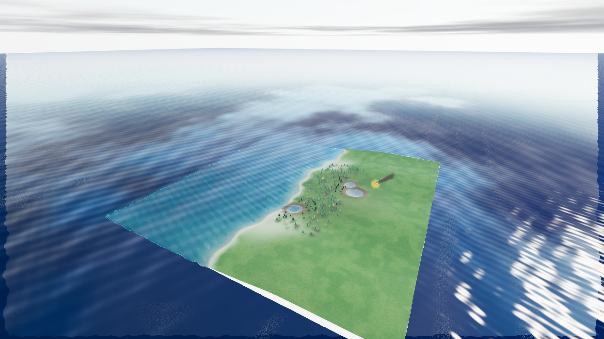

# Ускорение Армагеддона — 0.16.1

Проверка 21 октября 2026. Сравнивались рабочие модули редактора до и после
изменений, один браузер и окно 1280×720, сбалансированный профиль,
`examples/storm-coast.json`, сид сценария **16016**, одинаковая неподвижная
камера. Отдельная IndexedDB проверки не затрагивает пользовательские миры.

## Причины задержек и изменения

1. Каждый метеорит добавлял PointLight, затем скрывал или удалял его. Three.js
   получал новые варианты всех освещаемых материалов при изменении числа огней.
   Теперь один постоянный источник выбирает наиболее заметное освещение по
   расстоянию и мощности. Свечение тел, вспышки и пожары всех метеоритов остаются.
2. На каждом ударе пересоздавались InstancedMesh всего мира, включая три LOD.
   Теперь обновляются участки с кратером, удалёнными и обугленными объектами.
   Буферы дальнего леса остаются прежними.
3. Любая правка высоты сбрасывала всю траву рядом с камерой. Удары теперь
   инвалидируют только затронутые участки. Генерация новых участков ограничена
   шестью за кадр и бюджетом около 3 мс между участками: одиночный участок
   завершается целиком. Новая трава появляется постепенно.
4. Частицы пересчитывались и помечали GPU-буферы на каждом шаге 1/120 с.
   Теперь визуальные частицы обновляются раз на кадр; движение метеоритов,
   поиск контакта, порядок ударов и история остаются с фиксированным шагом.
5. Метеоритные эффекты исключены из дополнительных захватов отражения/преломления
   воды. Убрана полная синхронизация скрытого интерфейса на каждом ударе.

## Повторяемый прогон

Кнопка «Замер производительности» в `/storm-check.html`: 8 с прогрева,
8 с прогулки, 20 с Армагеддона, 8 с после остановки. Замер без открытых
меню и перемещения камеры. Оба прогона дали **9 ударов**, максимум **4 полёта**.

| Метрика во время Армагеддона | До | После |
|---|---:|---:|
| Средний интервал кадра | 61,69 мс | 52,39 мс |
| p95 интервала кадра | 125,0 мс | 97,1 мс |
| Самый длинный интервал | 590,5 мс | 187,5 мс |
| Кадров дольше 100 мс за 20 с | 23 | 13 |
| p95 CPU-времени кадра | 47,6 мс | 14,9 мс |
| Максимум CPU-времени | 592,2 мс | 104,2 мс |
| Шейдерных программ к концу сценария | 105 | 25 |
| Шейдерных программ после остановки | 77 | 21 |

До запуска сценария средний интервал был 50,76 / 51,70 мс соответственно.
Базовая сцена на этом проверочном окружении сама ограничена примерно 19–20 FPS:
это устранение дополнительных фризов сценария, а не обещание 60 FPS во всех мирах.
Сравнение — один прогон на версию, без статистики по разным GPU. CPU-время
включает отправку команд рендереру и возможное ожидание драйвера, не является
чистым временем JavaScript. После оптимизации остаётся стоимость формирования
кратеров, истории, перестройки коллизий и карт окружения при ударах.

Исходные данные: [до](storm-v0161/before.json), [после](storm-v0161/after.json).
Ошибок JavaScript и шейдеров нет. Повторение:
`npm run verify:storm`, `npm run preview`, открыть `/storm-check.html`.

`npm test`: **206 / 206**, ошибок и пропусков нет. Strict TypeScript,
production-сборка и автономный HTML собраны успешно.

Проверки регрессии: постоянное число огней при повторных запусках,
сохранение дальних instance-буферов, совпадение локального обновления леса
с полной перестройкой, постепенное восстановление травы, сохранение буферов
при удалённом ударе. Существующие тесты проверяют одинаковые удары при
10/30/144 FPS, паузу, остановку, сохранение и отмену последствий.

Для тяжёлых миров можно дополнительно выбрать «Экономный» профиль в меню
прогулки и отключить отражения в воде. Плотность растительности и размеры
мира при запуске сценария автоматически не уменьшаются.

