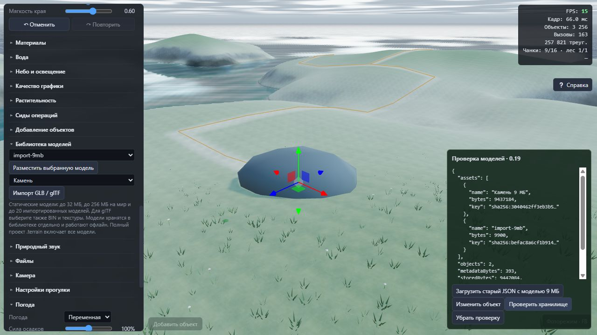
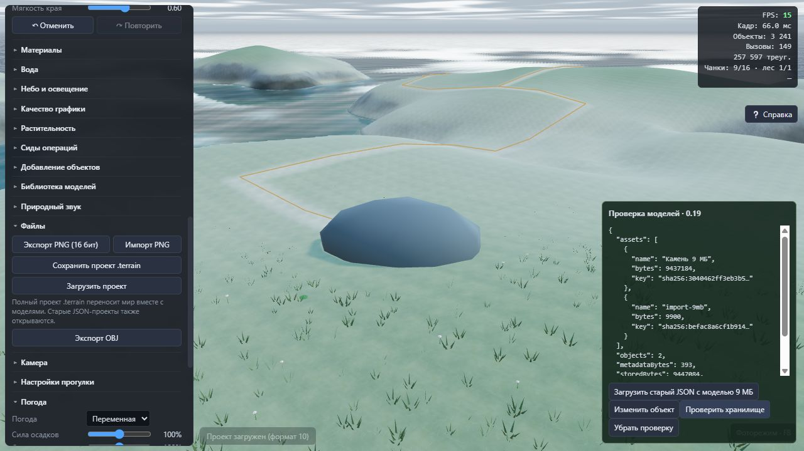

# Хранение моделей — версия 0.19.0

Проверено 23 октября 2026 г.

## Результат

Импортированные GLB теперь хранятся отдельными Blob в таблице `assets` базы IndexedDB. Документ мира, автосохранение и снимки undo/redo содержат только описание модели: идентификатор, название, категорию, вид коллизии, размер и ссылку `sha256:…`.

Модель больше не переводится в Base64 и не проверяется заново по двоичным данным при каждом изменении объекта, покраске, сохранении или сравнении снимков истории. Одна ссылка на содержимое может использоваться несколькими моделями и мирами. Ключ кэша подготовленной геометрии также заменён с полной строки GLB на короткую ссылку.

Лимиты увеличены до **32 МиБ на одну модель** и **256 МиБ уникальных моделей на мир**. Для glTF исходный файл, BIN и текстуры вместе должны помещаться в 32 МиБ. Сохраняются пределы 20 импортированных моделей на мир, 64 частей и 100 000 вершин на модель. Встроенная библиотека не входит в бюджет импортированных ресурсов.

## Сохранение и перенос

- Автосохранение записывает JSON документа со ссылками и список необходимых ключей. Существующие Blob при этом не переписываются.
- Копия мира использует те же двоичные ресурсы.
- **«Файлы → Сохранить проект .terrain»** создаёт один переносимый бинарный файл: JSON-манифест и все используемые GLB, без кодирования моделей в Base64.
- **«Загрузить проект»** принимает `.terrain` и старые `.json`.
- JSON с одними ссылками можно открыть при наличии ресурсов в локальной библиотеке. Для переноса между компьютерами следует использовать полный `.terrain`.

`projectJSON()` в API теперь возвращает документ со ссылками. Для переносимого экспорта добавлен `buildProjectBlob()`, для импорта файла — `loadProjectFile()`. `loadProjectText()` сохранён для JSON и прежних интеграций.

## Совместимость и целостность

Формат документа повышен до **10**, версия базы IndexedDB — до **2**. Существующие таблицы миров и последней сессии сохраняются; добавляется таблица ресурсов.

JSON-проекты форматов 1–9 по-прежнему открываются. При открытии старого проекта его встроенные GLB извлекаются, проверяются, получают SHA-256 ключи и сохраняются отдельно. В состояние редактора и историю попадают уже ссылки. Записи библиотеки преобразуются по мере открытия, без массового переписывания всех миров при запуске.

Модели проверяются до применения документа: размер, GLB, контрольная сумма, допустимая геометрия и наличие ресурсов. Двоичные ресурсы сохраняются одной транзакцией. Запись мира и указатель последней сессии также коммитятся вместе; сохранить новую запись со ссылкой на отсутствующий Blob нельзя.

Если преобразование старой записи не удалось из-за нехватки места, её исходный JSON остаётся целым. Если запись моделей прошла, а обновление документа не прошло, повторное сохранение завершает преобразование. Ошибка импорта не заменяет сцену частично и не добавляет запись истории.

Удаление записи мира не удаляет автоматически двоичные ресурсы: они могут быть нужны другим мирам и текущей истории. Автоматическая очистка неиспользуемых ресурсов в эту версию не входит.

## Формат полного файла

Контейнер `.terrain` версии 1:

1. Заголовок 20 байт: сигнатура `TERRAIN\0`, версия контейнера, длина JSON и число уникальных моделей; целые числа little-endian.
2. JSON-манифест UTF-8 формата проекта 10, до 32 МиБ.
3. Для каждой модели: 64 ASCII-символа SHA-256, длина GLB `uint32`, затем двоичные данные.

При чтении проверяются размеры, число записей, соответствие манифесту, дубликаты, контрольные суммы и отсутствие лишних байтов. Экспорт собирается из частей Blob и не строит гигантскую Base64-строку со всеми моделями.

## Проверки

**242 из 242 тестов прошли.** [Журнал тестов](assets-v019/tests.log).

Добавлены проверки:

- GLB размером 9 МиБ сохраняется один раз; редактирование, история и автосохранение не перечитывают и не записывают его двоичные данные повторно.
- Два идентификатора моделей и копии миров используют одну двоичную запись, сохраняя правильные имена и выбор модели.
- Полный файл загружается в пустую библиотеку; модели работают после undo/redo и повторного открытия.
- Отсутствующие ссылки, повреждённые Blob, неверные размеры и лимиты отклоняются до изменения сцены.
- База версии 1 и встроенные модели формата 9 преобразуются без сброса старой записи.
- Ошибки записи Blob или метаданных сохраняют предыдущий проект и допускают повторную попытку.
- Прерванная транзакция не оставляет частично записанный набор ресурсов.
- Невозможно сохранить мир и указатель сессии со ссылкой на отсутствующий ресурс.
- Контейнер отклоняет неподдерживаемую версию, несоответствие числа записей и лишние данные.

`npm run build` успешно выполнил генерацию GLB, TypeScript, Vite и автономную сборку. [Журнал сборки](assets-v019/build.log).

`npm run verify:assets` проверил диагностический TypeScript и собрал страницу `/asset-storage-check.html`. [Журнал проверки](assets-v019/verify.log).

В браузере на отдельной тестовой библиотеке проверены:

1. Открытие старого JSON с GLB размером **9 437 184 байта**. В документе осталось **183 байта описания модели**, двоичные данные находятся в отдельной записи. Это размер описания модели, а не всего документа с картами высот и покраски.
2. Изменение объекта, отмена и повтор: модель и её ссылка сохраняются. [Состояние](assets-v019/browser-edit-state.txt).
3. Импорт исходного GLB размером 9 МиБ через обычную кнопку библиотеки и размещение модели. Нормализация перепаковала этот тестовый файл до 9900 байт, удалив неиспользуемый тестовый блок. [Состояние импорта](assets-v019/browser-import-state.txt).
4. Перезагрузка страницы восстановила обе модели и объекты из IndexedDB, без GLB внутри JSON. [Восстановление](assets-v019/browser-restored-state.txt).
5. Экспорт через «Сохранить проект .terrain» и загрузка полученного файла через «Загрузить проект» в **другую пустую базу**. Восстановились два объекта и обе модели; зарегистрированных ошибок JavaScript нет. [Состояние после переноса](assets-v019/browser-fresh-import-state.txt), [проверочный файл](assets-v019/roundtrip.terrain).

Тестовая модель 9 МиБ содержит дополнительный неиспользуемый блок GLB: он нужен для проверки размера и хранения, а не для имитации нагрузки от сложной геометрии. Проверка не является замером FPS или тестом максимального потребления видеопамяти. Первый импорт и открытие модели всё ещё требуют чтения, проверки и подготовки геометрии; изменения исключают повторную обработку её файла при обычном редактировании и автосохранении.

Пользовательская библиотека в браузерных проверках не использовалась. Проверочные базы: `terrain-editor-assets-check` и `terrain-editor-assets-fresh-check`.

Корневой и `dist`-экземпляры автономного HTML совпадают: **6 606 601 байт**, SHA-256 `958e346d70359d51b1fb7e0b526868dbf821aaeea7bcc9969e5aa328c7b83aca`.

Повторная проверка: `npm test`, `npm run build`, `npm run verify:assets`, `npm run preview`, затем `/asset-storage-check.html`.
