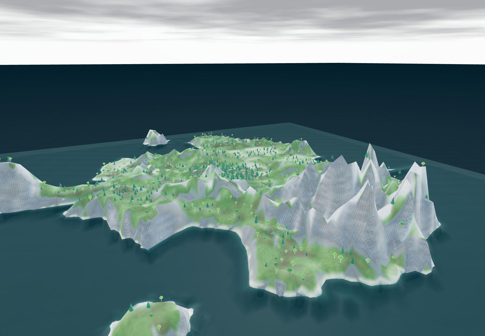
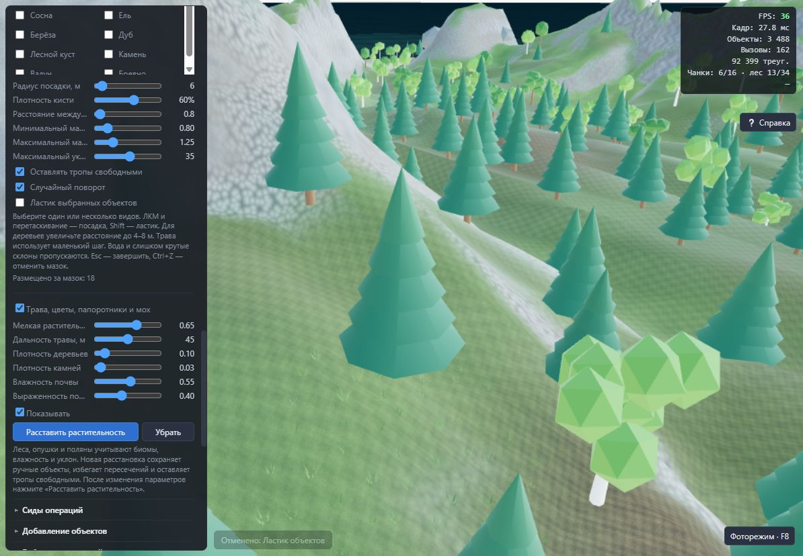

# Берега, отражения и кисть · версия 0.14.0 · 19 октября 2026

## Генерация берегов

Круговой спад заменён воспроизводимой береговой маской. Шум, вытянутые полуострова и глубокие заливы формируют основную сушу; отдельные острова имеют собственные пропорции и неровный берег. Сид определяет форму. Маска применяется к островам и уменьшенной территории, соблюдая выбранную площадь; полная карта с выключенным режимом острова сохраняет прежнее поведение.

Алгоритм генерации записывается в журнал с версией 4. Старые проекты сохраняют готовый рельеф; новая форма появляется при повторной генерации.

## Отражения

Флажок **«Отражения в воде»** находится в **«Качество графики»**. Существующая настройка также доступна в меню прогулки и сохраняется вместе с миром. Снятая галочка отключает отражения независимо от профиля качества. Экономный профиль при включённых отражениях использует небо, остальные профили могут отражать сцену.

## Ручная посадка

В **«Растительность» → «Кисть объектов»** можно выбрать несколько видов: траву, цветы, папоротники, мох, деревья, кусты, камни, брёвна и импортированные природные модели. Есть радиус, плотность, расстояние между объектами, диапазон масштаба, максимальный уклон, случайный поворот и сохранение свободных троп.

После включения кисти ЛКМ наносит объекты, перетаскивание продолжает мазок. Shift временно включает ластик, который удаляет только выбранные виды; есть и постоянный режим ластика. Esc завершает инструмент. Каждый мазок отменяется и повторяется одной операцией истории.

Посадка учитывает поверхность воды, уклон, коридоры троп и препятствия. Положение, размеры и повороты воспроизводимы по сиду операции. Результат хранится обычными ручными объектами проекта формата 8 и сохраняется при автоматической расстановке растительности. Отмена во время мазка откатывает его целиком; потеря фокуса завершает текущий мазок.

Добавлены четыре локальные GLB-модели мелкой растительности. Их геометрия использует инстансы, ветер и ограничение дальности видимости; они не отбрасывают тяжёлые тени и не получают шарообразную замену на дальнем уровне детализации. Ограничения: до 2 000 добавлений за мазок и до 20 000 моделей на проект. При достижении лимита мазка подсказка предлагает продолжить следующим мазком.

## Проверка

- Полный набор: **168 тестов, 0 ошибок**. После последних небольших правок повторно прошли 26 профильных тестов берегов, кисти, композиции и погоды.
- Strict TypeScript, обычная сборка, автономный HTML и сборка проверочной страницы прошли.
- Для трёх сидов при полном и уменьшенном размере проверены повторяемость высот, выраженная неровность берега и отдельные острова.
- Проверены посадка нескольких видов, вода, склоны, тропы, препятствия, ластик, очистка ссылок групп, отмена/повтор, лимиты, сохранение и сохранность ручных объектов после автоматической расстановки.
- В браузере обычными действиями кисти посажены 125 сосен и 50 пучков травы. Затем ластиком удалена трава, выполнена отмена удаления и добавлено ещё 18 пучков перетаскиванием. Переключатель отражений проверен в разделе качества. Ошибок в консоли при проверке не обнаружено.
- После повторного открытия страницы последняя сессия восстановилась из IndexedDB. Повторно экспортированный проект совпал с исходным по рельефу, покраске, объектам и группам, сидам, журналу операций, настройкам прогулки и отражений. Сохранились **193 ручных объекта: 125 сосен и 68 пучков травы**. Результат сравнения: [restoration.json](coast-brush-v014/restoration.json).

Проверка браузера использует отдельную библиотеку `terrain-editor-walk-check` и не заменяет пользовательские миры основной библиотеки.

## Пример

[natural-coast-brush.json](../examples/natural-coast-brush.json) — готовый проект с сидом **3403971791**, неровными берегами и ручной посадкой. Загрузить через **«Файлы» → «Загрузить проект»**. Отражения в примере выключены.

