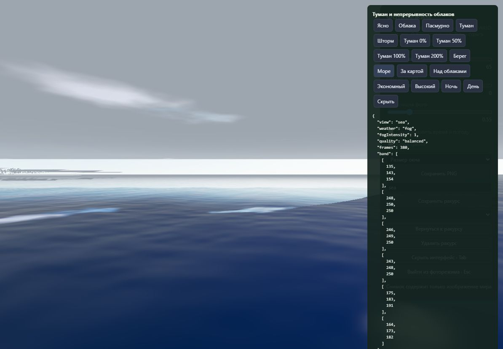
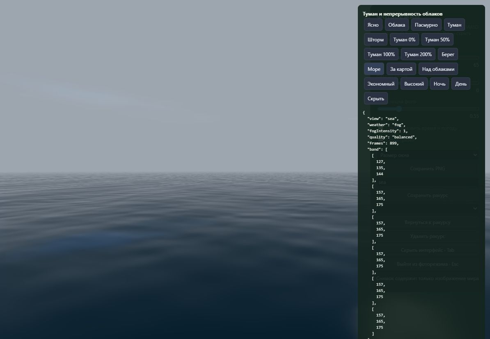
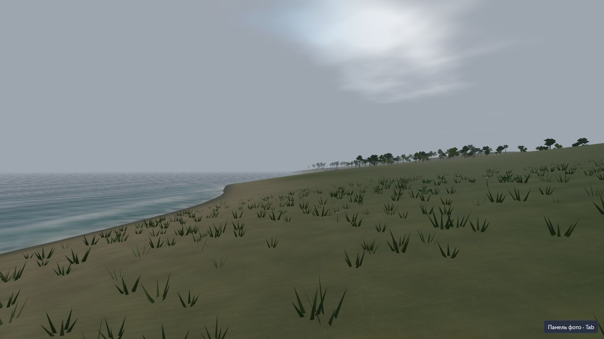
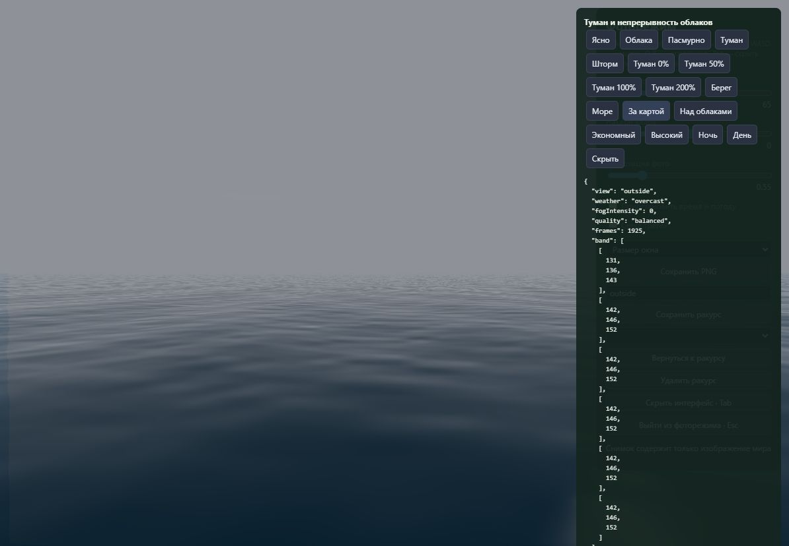
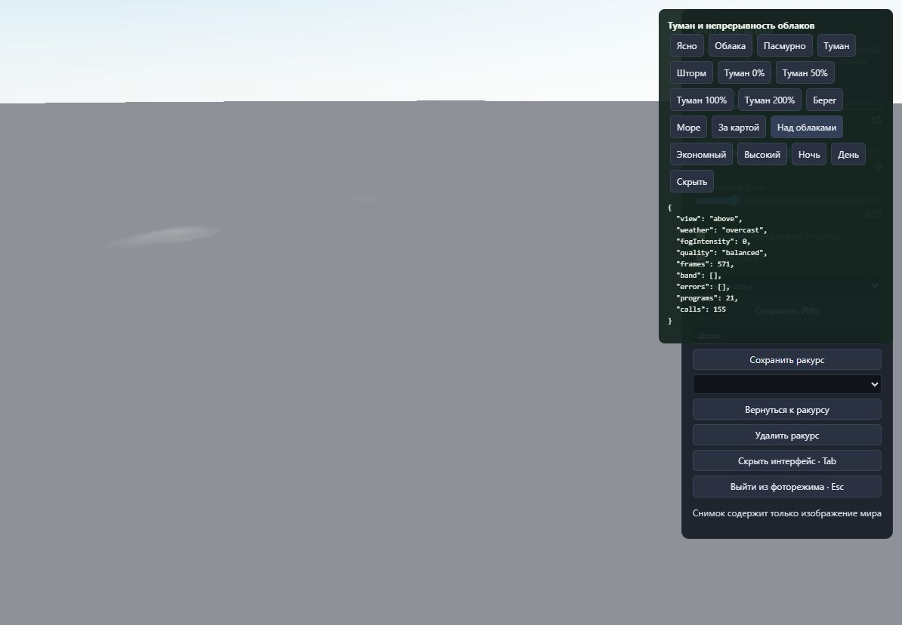

# Туман и облачность — 0.17.1

Проверено 22–23 октября 2026 года в браузере с WebGL2.

Причины дефекта: небо получало туман только при плотности выше 0,008,
а у обычного погодного тумана она около 0,0037. Облака рисовались на
плоскости 26 × 26 км, причём сплошная облачность отключала затухание
у её края. Дополнительно Sky из Three.js рисовал собственные облака.

## Изменения

- Небо и звёзды используют ту же плотность тумана, что земля и вода.
  Приближение оптического пути `90 / max(0,005, направление.y)` создаёт
  плавное усиление дымки к горизонту. Цвет смешивается после тонального
  преобразования, в том же пространстве, что туман материалов Three.js.
  Нулевое значение отключает эффект. Прежняя кривая силы сохранена:
  при 200% контраст объекта на расстоянии 4 м меньше 1%.
- Непрерывное поле облаков проецируется на сферический слой высотой
  750 м. Размер карты, положение камеры и дальняя плоскость отсечения
  больше не ограничивают покрытие. Дальние октавы шума фильтруются.
  Независимые облака из Sky отключены.
- На обычной высоте облака объединены с фоном неба. Над слоем и рядом
  с высокими вершинами включается наложение с реальной глубиной, чтобы
  облака закрывали расположенную под ними поверхность. Отражённая камера
  и карта освещения окружения используют то же поле и настройки погоды.
- Детали, полностью скрытые туманом, не вычисляются. Обновление PMREM при
  изменении силы тумана ограничено по частоте. Края отражений воды плавно
  переходят в фоновое отражение вместо резкого прямоугольного стыка.

Новые буферы захвата и текстуры не добавлены. В прогулке отдельный проход
облаков убран; при полёте используется один проход вместо прежней плоскости.
Сравнительный замер FPS в рамках этого исправления не проводился.
Это приближение атмосферного рассеивания и облачного слоя, без объёмного
марширования лучей.

## Проверки

- `npm test`: **220 / 220**. Четыре новые проверки покрывают оптический путь,
  непрерывность у прежнего края облачной плоскости, совпадение пересечений
  с геометрической трассировкой и общие настройки неба/окружения.
- `npm run build`: TypeScript, Vite, локальные модели, самостоятельный HTML
  и отдельная лаборатория WebGPU успешно собраны.
- `npm run verify:fog`: строгая проверка TypeScript диагностических страниц
  и сборка страницы с настоящим редактором и изолированной IndexedDB.
- В браузере проверены берег, открытое море, камера за картой на X = 6000 м,
  высота 1500 м, нулевая и максимальная сила, день/ночь, три профиля качества.
  В окончательных проверках ошибок шейдеров и потери WebGL-контекста нет.
- На контрольном морском ракурсе при обычном тумане RGB пяти полос от
  горизонта вверх совпадает: **157, 165, 175**. Прежняя яркая полоса
  доходила до **246, 249, 250**. Рябь и близкие поверхности сохраняют контраст.
- Проверена загрузка готового самостоятельного HTML с восстановлением
  тестового мира и туманом. В тестовой копии изменено только имя IndexedDB;
  пользовательская библиотека не затронута. Сборщик отдельно проверяет
  отсутствие внешних ресурсов и модульных импортов.

Самостоятельные файлы в корне и `dist` идентичны. SHA-256:
`12C76312C01AEEAC9AC0384981C7D595006B89D5A916797BDD885703DB09046E`.

Повторение: `npm run build`, `npm run verify:fog`, `npm run preview`,
затем `/fog-check.html`. Переходы погоды и камеры плавные; перед снимком
следует дождаться их завершения. Все результаты находятся в `fog-v0171/`.

## Снимки

Исходная полоса и край облаков:

Обычный туман над морем:

Берег, сила тумана 50%:

Нулевая сила тумана, облака за пределами карты:

Вид сверху: облака перекрывают поверхность под ними:

