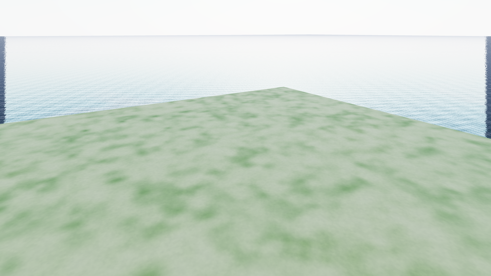
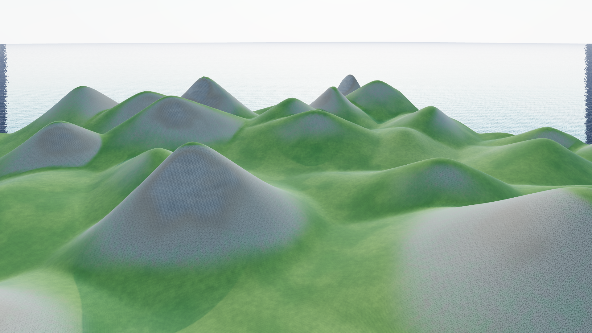
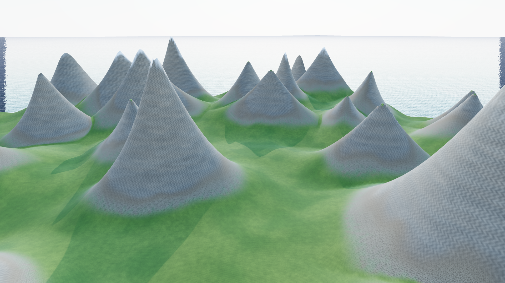

# Ползунки генерации · версия 0.14.2

«Острота гор» теперь охватывает весь диапазон от плоской равнины до острых крутых пиков. Генерация использует вершины с разными высотами, основаниями и пропорциями. Это позволяет усиливать крутизну отдельных гор без превращения целых линий шума в тонкие стенки. Низкие и средние значения сглаживаются сильнее; максимальное значение сохраняет острые вершины.

## Поведение параметров

| Параметр | Результат |
| --- | --- |
| Острота гор, 0–5 | 0 — ровная равнина; 1 — холмы; 2–3 — горные массивы; 4–5 — крутые склоны и острые вершины. |
| Высота, м | Предельный подъём над равниной. 0 тоже даёт равнину. При остальных равных увеличение высоты пропорционально усиливает внутренний рельеф; прибрежная полоса сохраняет переход к воде. |
| Масштаб | Больше значение — крупнее формы по горизонтали и меньше мелких массивов. Вертикальная высота задаётся отдельно. |
| Доля гор, 0–100% | Определяет распространение горных областей по суше. 0% оставляет только низкие холмы, 100% распространяет горные области на всю сушу. При остроте 0 рельеф остаётся плоским при любой доле. |
| Октавы | Добавляют мелкие детали, сохраняя крупные формы и высотный бюджет. Верхняя граница ползунка учитывает плотность сетки на выбранной площади и масштаб. |
| Искажение | 0 — исходная форма; увеличение изгибает массивы и долины. Не растягивает весь результат до одинаковой максимальной высоты. |
| Размер территории | Задаёт ширину области генерации от 128 до 1024 м. Уменьшенная область окружена водой; плотность сетки на ней определяет доступную детализацию. |
| Сид | Повторяет тот же результат при тех же параметрах. |

Равнина располагается на **3 м выше воды**. Острота и доля гор определяют, насколько используется заданный бюджет высоты: он не является обещанием высоты каждой вершины. Глобальная нормализация, которая раньше скрывала влияние ползунков, убрана.

При включённом острове равнина остаётся плоской внутри суши, а берег и морское дно сохраняются. Нулевое значение не превращает всю карту вместе с океаном в одну плоскость.

Параметры применяются кнопкой **«Сгенерировать»**. Горный пресет использует остроту **4,2**. Готовые проекты открываются с сохранёнными высотами; изменения генератора применяются при новой генерации. Формат проекта остаётся **8**, версия алгоритма — **6**; прежние записи операций читаются.

## Проверка

- **181 тест, 0 ошибок**. Восемь новых тестов проверяют нулевые значения, рост крутизны по диапазону, пропорциональность высоты, распространение гор, горизонтальный масштаб, доступные октавы, искажение и сохранение/отмену нулевых настроек.
- Прошли проверки островов и маленьких территорий, пресетов и маршрутов, физики, отмены генерации, сохранения и экспорта.
- Strict TypeScript, обычная сборка, автономный HTML и проверочная страница прошли.
- В браузере проверены значения остроты 0 и 5, генерация кнопкой, сохранение проектов и PNG. Экспортированные высоты **побитно совпали** с результатом эталонной генерации при сохранённых параметрах; файлы прошли полную проверку загрузчика. Ошибок в консоли нет.
- Проверены нулевые нижние границы остроты и высоты. При масштабе 0,3 верхняя граница октав равна 3, при масштабе 3 — 7 на сетке 256 и полной площади. Диапазон действительно изменяется в интерфейсе.
- Использовалась отдельная IndexedDB-библиотека `terrain-editor-walk-check`; основная библиотека миров не заменялась.

## Контрольный пример

Одинаковые сид **1337**, сетка **256 × 256**, высота **230 м**, масштаб **1**, доля гор **100%**, искажение **0**, четыре октавы. Меняется только острота. Угол — 99-й процентиль уклона внутренних узлов сетки, а не уклон всей поверхности.

| Острота | Перепад высот, м | Уклон, градусы |
| --- | ---: | ---: |
| 0 | 0 | 0 |
| 1 | 67,5 | 28,3 |
| 2,5 | 128,6 | 50,4 |
| 5 | 209,7 | 69,9 |

[Числа по всему диапазону](generation-controls-v0142/metrics.json) · [Проверка браузера](generation-controls-v0142/browser-check.json)

[Пример проекта](../examples/generation-controls.json) — загрузить через «Файлы» → «Загрузить проект». Начальное значение остроты — 2,5. Для сравнения передвинуть ползунок к 0 или 5 и нажать «Сгенерировать». Пример намеренно не содержит растительности, чтобы форма рельефа была хорошо видна.

Воспроизведение примера: `npx tsx verification/build-generation-controls.ts`.

Острота 0:

Острота 2,5:

Острота 5:

