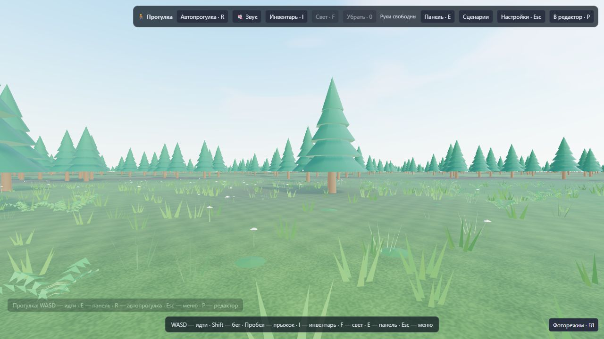
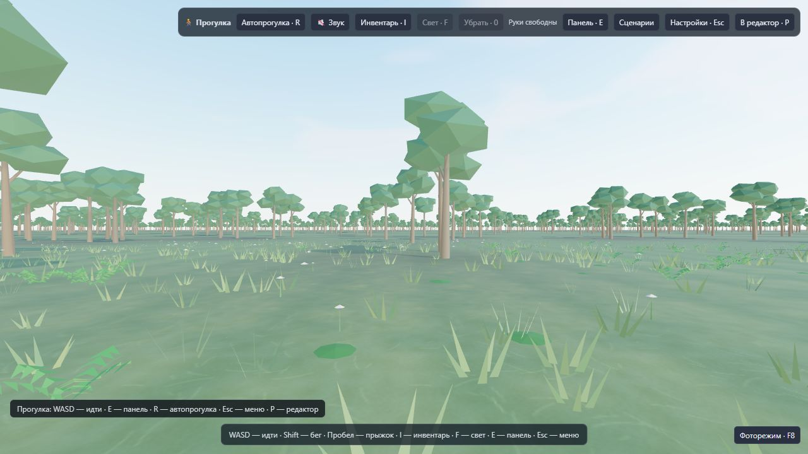
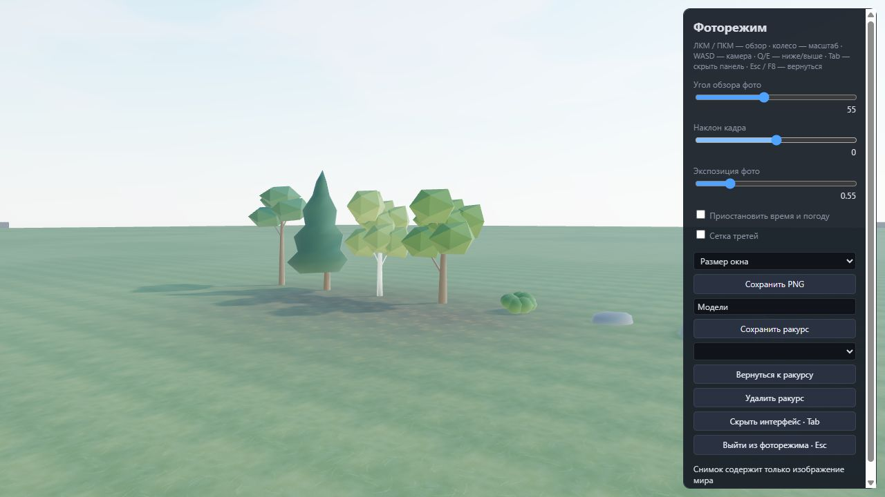
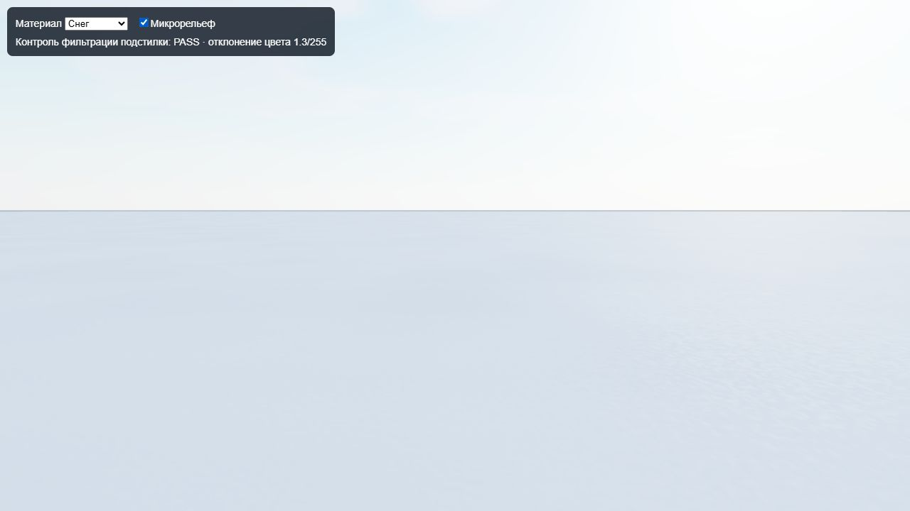

# Графика 0.17.0 — пункты 1–5

Проверено 22 октября 2026 года. Изменены рабочие модули редактора,
локальные GLB и автономный HTML. Формат проекта остаётся 8.

## Изменения

1. Согласованы цвет и интенсивность солнца, полусферического освещения,
   отражённого света неба, тумана и горизонта воды. Уменьшены чрезмерно яркие
   зелёные оттенки; существующие ACES и управление экспозицией сохранены.
   Дополнительных источников света и проходов рендера нет.
2. Переработаны сосна, ель, берёза, дуб, куст, камень и валун. У сосны
   асимметричная открытая крона, у ели неровные ярусы; у лиственных деревьев
   разные группы ветвей и мягкие нормали. Камни имеют неоднородный контур,
   приплюснутое основание и вариацию цвета вершин. Все модели непрозрачные.
3. Переработаны восемь бесшовных карт земли: мелкие стебли травы, слои и
   трещины скалы, песчаная рябь, снег, опавшие листья, почва, отдельные камни
   гравия и подушки мха. Структура рассчитывается один раз при запуске,
   без фоновой работы на каждом кадре. В шейдере сокращён повторный расчёт
   мелкого шума, усилен существующий микрорельеф вблизи камеры.
4. Оттенок природного объекта определяется его постоянным ID и asset;
   перемещение, отмена, загрузка и смена LOD не меняют оттенок. Пользовательский
   tint учитывается. Импортированные модели сохраняют прежнее поведение tint.
   Новая расстановка даёт небольшие различия пропорций по осям: реальный scale
   сохраняется в документе и используется рендером, физикой и проверкой троп.
   Версия алгоритма расстановки — 5. Готовые позиции и масштабы старых миров
   при загрузке не перегенерируются.
5. LOD природных объектов используют те же формы, материалы и палитру,
   сохраняют центр и габариты полной модели. У каждого дерева не больше двух
   частей на любом уровне; у куста одна. У дерева корень остаётся на оси
   коллизии; габариты четырёх пород согласованы с прежними GLB, что сохраняет
   проходимость старых миров. Импорт и постройки продолжают работать.

## Проверка бюджета

Числа — треугольники одной модели, LOD 0 / 1 / 2:

| Модель | 0.16.2 | 0.17.0 |
|---|---:|---:|
| Сосна | 112 / 44 / 32 | 112 / 44 / 28 |
| Ель | 128 / 44 / 32 | 120 / 44 / 32 |
| Берёза | 344 / 80 / 40 | 282 / 60 / 36 |
| Дуб | 272 / 80 / 40 | 232 / 60 / 36 |
| Куст | 560 / 20 / 20 | 560 / 20 / 20 |
| Камень, валун | 80 / 20 / 20 | 80 / 20 / 20 |

Карт земли по-прежнему две: массив цвета и массив высоты/шероховатости,
каждый из восьми слоёв 128×128 RGBA8. Базовые пиксели занимают **1 048 576
байт** суммарно; размеры и число mip-уровней прежние. Профили качества,
плотность растений, дистанции LOD и разрешение отрисовки не увеличены.

Данные: [до](graphics-v017/budget-before.json),
[после](graphics-v017/budget-after.json). Проверки бюджета, границ LOD,
непрозрачности, корректности цветов GLB, постоянства оттенков и сохранения
пропорций входят в автоматические тесты.

## Измерение в браузере

Intel UHD Graphics, ANGLE / Direct3D11, 1280×720, сбалансированный профиль.
Одинаковые исходные файлы миров, камеры, солнце, ветер и настройки качества.
В лесу сетка 512 и 3000 деревьев. После прогрева 4 с — обычная сцена 8 с,
Армагеддон 20 с, восстановление 4 с; сид Армагеддона 16016. На побережье
прогрев 4 с и обычная сцена 8 с. Сборка и тесты во время замера не запускались.

Полное время кадра — реальные интервалы requestAnimationFrame. GPU измерен
отдельно через асинхронный EXT_disjoint_timer_query_webgl2 вокруг кадров
рабочего редактора, включая его буферы воды и тени. Нет gl.finish или
активного ожидания GPU; disjoint = 0. Этот измеритель подключён только
к диагностическим страницам, в рабочую и автономную сборки не входит.

| Сцена | Среднее время кадра до → после | p95 кадра до → после | Среднее GPU до → после |
|---|---:|---:|---:|
| Лес | 50,04 → **45,43 мс** | 55,7 → **48,9 мс** | 43,17 → **38,43 мс** |
| Лес, Армагеддон | 50,35 → **45,72 мс** | 83,5 → **69,6 мс** | 43,31 → **38,61 мс** |
| Побережье | 53,07 → **46,59 мс** | 76,5 → **76,4 мс** | 45,79 → **40,03 мс** |

В обычном лесу среднее число вызовов отрисовки снизилось с 489,35 до 465,68,
число шейдерных программ осталось 15. В Армагеддоне обе версии выполнили
9 ударов, программы — 19. Ошибок JavaScript/шейдеров и потери контекста нет.
Число экземпляров мелкой растительности в лесу — 3030 в обеих версиях;
у берега — 2773 / 2780: изменённый контур камней немного меняет отсев травы
рядом с ними, исходные объекты и настройки плотности одинаковые.

Редкие задержки Армагеддона остаются: по 5 интервалов свыше 100 мс в каждой
версии; максимальный интервал снизился с 194,4 до 173,6 мс. Это результат
на данном устройстве и сценах, не обещание 60 FPS для любого мира и оборудования.

[Сводка с полными числами](graphics-v017/comparison.json).
Сырые результаты:
[кадры леса до](graphics-v017/browser-before-forest-final.json),
[после](graphics-v017/browser-after-forest-final.json),
[GPU леса до](graphics-v017/gpu-before-forest.json),
[после](graphics-v017/gpu-after-forest.json),
[кадры побережья до](graphics-v017/browser-before-coast-final.json),
[после](graphics-v017/browser-after-coast-final.json),
[GPU побережья до](graphics-v017/gpu-before-coast.json),
[после](graphics-v017/gpu-after-coast.json).

Ранние попытки с ограничением фонового браузера примерно до 1 FPS исключены.
Данные browser-after-forest-idle.json помечены measurementValid: false.
Промежуточный прогон browser-after-intermediate.json не используется в таблице:
он предшествовал окончательной подгонке габаритов моделей. Исходные ранние
замеры без GPU-таймера также сохранены отдельно.

## Проверки и повторение

- Полный набор: **216 тестов пройдены**; дополнительно повторены проверки
  графики после ограничения цветов вершин диапазоном GLB 0–1.
- Strict TypeScript, Vite, автономный редактор и отдельная WebGPU-лаборатория
  собраны. Корневой и dist-вариант автономного HTML идентичны.
- Проверены бюджеты всех трёх LOD, стыки карт, сохранение оттенков и масштабов,
  столкновения с деревьями и камнями, проход по склонам и мостам.
- Ручная проверка профилей качества и дневной/ночной палитры — на отдельной
  галерее диагностической страницы; пользовательская библиотека не используется.
- Восемь материалов просмотрены с микрорельефом. Проверка фильтрации подстилки
  на границе плитки и последнем mip-уровне — PASS, отклонение 1,3/255;
  ошибок и предупреждений браузера нет.
  [Данные](graphics-v017/surface-result.json).

Команды: `npm test`, `npm run build`, `npm run verify:graphics`,
`npm run verify:surface`, `npm run preview`.
Открыть `/graphics-check.html` и `/graphics-before.html`, выбрать одинаковую
сцену и запустить замер; `/surface-check.html` проверяет mip-фильтрацию и
позволяет просмотреть все материалы. Библиотека проверки — отдельная IndexedDB.
Для собранных сырых данных: `npx tsx verification/summarize-graphics.ts`.

SHA-256 автономного редактора:
`A061F8BA41FE2BAC2FFCD3131F43BD1580F262DD760173B3053ED11225A79447`.

## Изображение

До:

После:

Галерея новых моделей:

Подстилка с микрорельефом:

