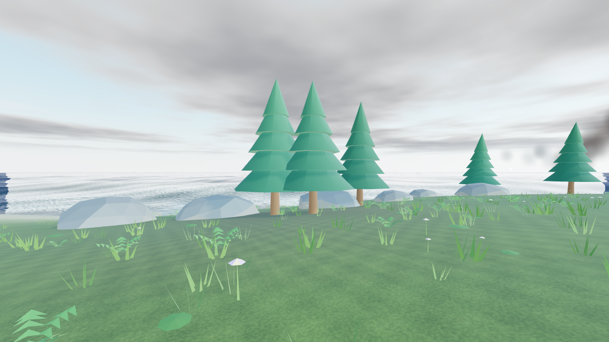

# Удары по земле — ускорение в 0.16.2

Проверка 21 октября 2026. После оптимизации полётов в 0.16.1 оставались
задержки именно при формировании кратеров. Отдельный замер локализовал
главную причину: пересоздание Rapier.World с сеткой 512×512 и 3000 коллизиями
деревьев занимало 426–454 мс на каждый удар.

## Что изменено

- Треугольная коллизия всего рельефа заменена нативной Rapier Heightfield
  с обработкой внутренних рёбер. Ориентация массива согласована с сеткой
  редактора; диагонали и высоты двух треугольников каждой ячейки совпадают.
  При правке рельефа обновляется соответствующая область массива высот.
  Rapier получает обновлённую форму без построения BVH сотен тысяч треугольников.
- При ударе физический мир и контроллер персонажа сохраняются. Удаляются
  разрушенные коллизии, меняется высота опор оставшихся объектов. Неизменённые
  формы переиспользуются, перекраска дерева сама по себе не меняет коллизию.
  Позиции и скорости плавающих тел сохраняются. Обновление пространственных
  запросов выполняется нулевым шагом без продвижения физического времени.
  Полная загрузка мира или изменение конфигурации по-прежнему создаёт новую физику.
- Карта контактного затемнения обновляется плитками только рядом с кратером,
  исчезнувшими и изменёнными объектами. Учтены радиус выборки склонов и тени
  удалённых моделей. Сохранён кэш границ объектов; убраны сотни тысяч временных
  массивов выборок. Посторонняя правка рельефа включает полный пересчёт.
- Удар всегда записывает операцию с сидом, поэтому для его фиксации не требуется
  вторая полная копия документа и сравнение. Предыдущий снимок, отмена, повтор,
  атомарный откат ошибки и стек повтора сохраняются.
- Проверка погрешности LOD больше не создаёт функцию выборки высоты для каждой
  вершины при обновлении участка. Изображение, кратеры и размеры метеоритов сохранены.
- Шейдеры вспышки и ударного кольца подготавливаются через `compileAsync`
  заранее, пока метеорит летит. Плоское двустороннее кольцо рисуется за один
  проход, без дополнительного варианта шейдера для обратной стороны.

## CPU-замер одного удара

Сетка **512**, **3000 деревьев**, сид 431, метеорит радиусом 12 м, сухая ровная
земля. В обоих вариантах одинаковые исходные высоты, объекты и точка удара.
По четыре запуска; таблица — медиана трёх после первого прогрева. Это Node/WASM
без GPU и интерфейса, не показатель полного времени кадра или FPS.

| Этап | 0.16.1 | 0.16.2 |
|---|---:|---:|
| Обновление физики | 430,3 мс | 4,4 мс |
| Обновление сетки/LOD | 13,7 мс | 2,0 мс |
| Дополнительная работа истории | 13,0 мс | 5,9 мс |
| Контактное затемнение | 27,3 мс | 7,5 мс |
| Вся транзакция удара | 38,1 мс | 21,4 мс |
| Последствия вместе с физикой, затемнением и течением | 495,5 мс | 36,3 мс |

Медианы этапов нельзя складывать: для каждого столбца они берутся отдельно.
Один удар в новом расчёте обновил **12 288 из 65 536** пикселей затемнения.
Первый запуск с прогревом в новой версии дороже последующих; сохранены сырые
значения, включая этот запуск. Результаты зависят от компьютера и содержимого мира.

Данные: [до](impact-v0162/node-before.json), [после](impact-v0162/node-final.json).
Повторение: `npm run benchmark:impact`.

## Браузерная проверка

Рабочие модули редактора, отдельная IndexedDB, сбалансированный профиль,
окно 1280×720. Прогрев 8 с, прогулка 8 с, Армагеддон 20 с, 8 с после остановки.
Мир [impact-forest.json](../examples/impact-forest.json): сетка 512, 3000 деревьев,
все точки падения первоначально на сухой земле. Сид сценария **16016**.

- **9 ударов**, максимум **4 одновременных полёта**.
- Число полных перестроек Rapier не изменилось между прогулкой и сценарием:
  обновлялась существующая карта высот. Последнее обновление физики — **2,4 мс**.
- Ни одного полного пересчёта затемнения во время серии; 8 локальных обновлений
  с объединением близких по времени ударов. Последнее — **2 мс**, 6144 пикселя.
- Средний интервал кадра: **47,46 мс** до сценария и **47,86 мс** во время.
  CPU p95: **6,9 / 9,9 мс**, максимум CPU во время сценария — **45,7 мс**.
- Отдельные длинные интервалы отрисовки остаются: максимальный интервал **229 мс**.
  Это не обещание отсутствия всех задержек или 60 FPS. Сцена на этом окружении
  ограничена примерно 21 FPS даже без сценария; GPU, компиляция первых эффектов,
  сохранение и прочие задачи браузера не входят в отдельный CPU-замер выше.
- Ошибок JavaScript и шейдеров нет. Сценарий остановлен, кратеры сохранены.

[Данные браузера — лес](impact-v0162/browser-forest.json).
Отдельный повтор на побережье: [данные](impact-v0162/browser-coast.json).
В нём CPU p95 составил 12 мс, максимум CPU — 103,2 мс; редкий длинный кадр
на небольшом мире сохранялся. Это не опровергает отдельное измерение физики:
полное время кадра включает отрисовку и другие системы.

Следующий прогон после подготовки шейдеров потерял WebGL-контекст и был
**исключён из результатов**. Его ошибочно низкие времена нельзя использовать
для сравнения. В файле [отброшенный прогон](impact-v0162/browser-prepared.json)
указано `renderValid: false`. Стенд теперь прерывает замер при потере контекста
и помечает данные как недействительные. После перезагрузки изображение
восстановилось; такая перезагрузка не требуется для загрузки пользовательских
проектов или применения самой оптимизации.

Повторная проверка после восстановления контекста подтвердила изображение,
падения и кратеры с подготовкой шейдеров. [Действительные данные](impact-v0162/browser-recovered.json):
`renderValid: true`, список ошибок пуст. Этот короткий прогон подтверждает работу
эффектов; он не используется для сравнения FPS.

Повторение: `npm run verify:storm`, `npm run preview`, `/storm-check.html`,
кнопка **«Замер ударов по суше»**.

## Проверки

**211 / 211** тестов пройдены. Новые тесты сравнивают высоты Rapier с точными
треугольниками изображения до и после локальной правки, проверяют сохранение
плавающего тела и скорости, переиспользование коллизий после обугливания,
совпадение локального затемнения с полным после серии ударов и безопасный
полный пересчёт после посторонней правки. Проверена отмена, повтор и откат
ошибки без потери стека повтора в облегчённой транзакции.
Проверяется и подготовка материалов взрыва до первого удара.

Существующие проверки проходят маршрут лес → мост → озеро → видовая точка,
склоны, ступеньки, неравномерные ячейки, плавание и удары при разном FPS.
