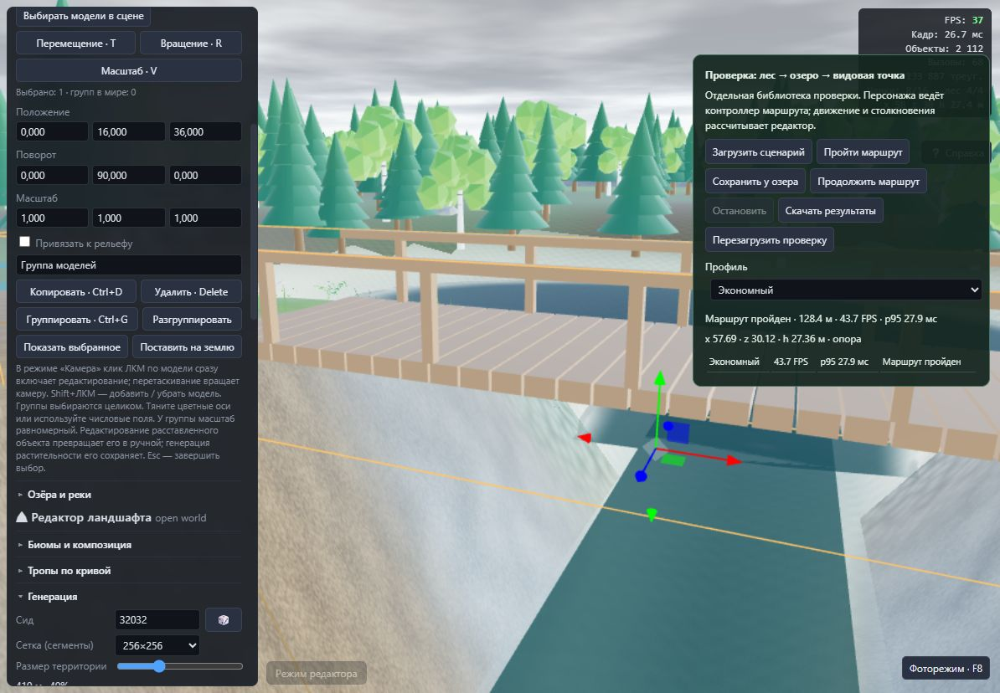

# Управление · версия 0.13.1 · 18 октября 2026

Исправлены три проблемы: ложные остановки на неровностях, необходимость включать выбор моделей отдельной кнопкой и медленное приближение камеры.

## Движение

До Rapier выполнялась дополнительная проверка подъёма: сглаженная билинейная высота сравнивалась с высотой опоры на треугольниках. Даже небольшая разница, делённая на короткий шаг обычной ходьбы, могла запретить движение. Регрессионный тест воспроизвёл отбрасывание движения до исправления.

Теперь при подключённой физике уклоны и ступени обрабатывает Rapier. Коррекция положения капсулы и высота под камерой используют те же треугольники, что и коллизия. Увеличены автошаг до 0,5 м, дистанция удержания опоры на спуске до 0,4 м и допустимый подъём до 45°. Сохраняются столкновения со стенами, деревьями, большими камнями и крутыми склонами. Луч для редактирования и проверки перекрытия объектов рельефом тоже использует треугольную поверхность.

## Выбор и зум

В режиме «Камера» обычный клик ЛКМ по видимой модели открывает её редактирование, включая объект из процедурной расстановки. Движение указателя больше 5 пикселей считается перетаскиванием камеры; возврат курсора в исходную точку не превращает его обратно в клик. Выбор не перехватывает кисти, рисование троп и воды, выбор старта, прогулку, фоторежим или Alt/Ctrl/Meta-жесты камеры. Существующий выбор групп и Shift+ЛКМ сохранён.

OrbitControls приближает в сторону курсора с `zoomSpeed=2.8` вместо 1.2. Минимальная дистанция уменьшена с 5 до 0,75 м. Сохранены сглаживание и штатная нормализация пикселей/строк/страниц колеса и жестов тачпада.

## Проверка

- **162 теста, 0 ошибок**; strict TypeScript, обычная и автономная сборки прошли.
- Реальный Rapier: неровные неплоские ячейки при 10/60/144 FPS без Shift и прыжков; небольшие брёвна, склон 43°, препятствия и крутой склон 55°. Существующие проверки прыжков, мостов, причалов, проходов домика/пещеры и стен прошли.
- Настоящий OrbitControls получает события колеса: проверены отклик с дистанции 2/10/1000 м, направление к курсору, разные единицы прокрутки и нижняя граница приближения.
- В браузере пройден маршрут «лес → озеро → мост → видовая точка»: **128,4 м**, экономный профиль, 43,7 FPS, p95 27,9 мс. Это один контрольный проход, а не обещание такой скорости во всех мирах. Исходные кадры: [walk-results.json](interaction-v0131/walk-results.json).
- В браузере обычным кликом выбрана сосна `walk-tree-118`, после Esc проверено вращение перетаскиванием без нового выделения. Затем колесом выполнено приближение к мосту и обычным кликом выбран `walk-bridge`. Ошибок в консоли нет. Использовалась отдельная библиотека контрольного мира.

