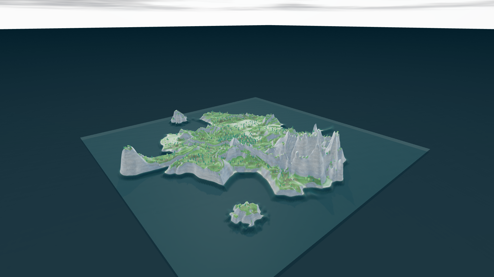
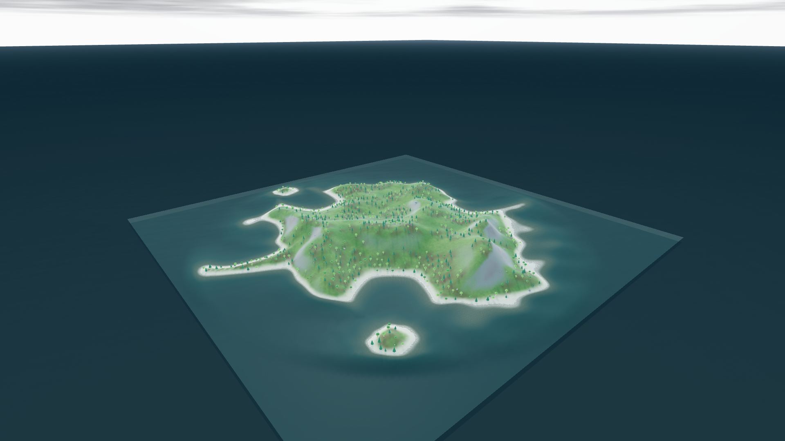
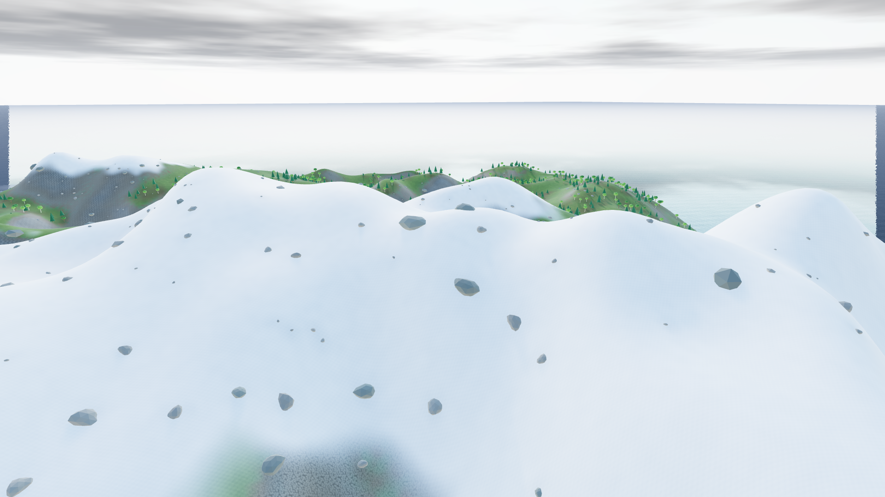

# Естественные берега и горы · 0.14.1 · 19 октября 2026

## Причина

У прежней функции гребней был излом в каждой вершине. Обратная связь между октавами усиливала узкие пики. Мелкие октавы сильного искажения координат дополнительно складывали широкие горы в почти вертикальные складки. У берега весь перепад между дном и горой высотой до 170 м смешивался в полосе шириной всего несколько ячеек.

## Изменения

- Гребни имеют гладкую вершину, мелкие октавы слабее и не усиливают друг друга. Крупные массивы и долины определяют форму; подробности подбираются с учётом разрешения сетки.
- Искажение координат использует крупные формы и умеренную амплитуду. Дополнительное сглаживание высот учитывает размер территории и шаг сетки. Оно выполняется до формирования берегов, сохраняя небольшие острова.
- Береговая высота растёт постепенно с расстоянием от воды. Горы не обрываются целиком на урезе воды; маленькие острова остаются невысокими. Подводный склон плавно переходит в дно.
- Сглажены соединения заливов с основной сушей. Полуострова изгибаются и сужаются к оконечности, их ширина меняется по длине.
- Выбор детализации чанков учитывает видимую погрешность высоты. Удалённые маленькие острова и гребни сохраняют форму, пока упрощение заметно на экране. Плоская и достаточно далёкая поверхность продолжает упрощаться. Общие границы чанков, полная геометрия для физики и экспорта сохранены.

Все вычисления генерации остаются в отменяемом Web Worker. Новые операции рельефа записываются с версией алгоритма **5**. Старые операции и проекты читаются; сохранённые высоты существующего мира не изменяются автоматически. Обновлённый рельеф получается кнопкой **«Сгенерировать»** или созданием пресета. Формат проекта остаётся **8**.

## Измерения

Один и тот же сид **1337**, сетка **256 × 256**, шаг **4 м**, одинаковые параметры до и после. «Пик над соседями» — максимальное превышение локальной вершины над самым высоким из четырёх соседних узлов. Это проверка игольчатых выбросов, а не высоты горы.

| Сценарий | Показатель | До | После |
| --- | --- | ---: | ---: |
| Остров, настройки по умолчанию | Пик над соседями, м | 17,74 | 0,45 |
| Остров, настройки по умолчанию | 99-й процентиль изменения уклона¹ | 35,47 | 1,17 |
| Горный пресет | Пик над соседями, м | 32,62 | 0,26 |
| Горный пресет | Максимальная высота, м | 230 | 227,47 |

¹ Используется модуль дискретного лапласиана высоты `|4h − hлев − hправ − hверх − hниз|`, в метрах при указанном шаге сетки. Меньшее значение означает отсутствие резких изломов между соседними склонами.

Исходные числа для нескольких сидов: [before.json](natural-relief-v0141/before.json), [after.json](natural-relief-v0141/after.json).

## Проверка

- **173 автоматических теста, 0 ошибок**. Добавлены пять тестов формы склонов и вершин, берегов, крайних настроек и всех разрешений, видимой погрешности LOD, сохранения версии алгоритма и отмены/повтора.
- Проверены острова с сидами 1337, 17, 456 и 3403971791, горный пресет, максимальные острота и искажение. Тесты композиции и доступных маршрутов на полной карте и маленьких островах прошли.
- Strict TypeScript, обычная сборка, автономный HTML и проверочная страница прошли.
- В браузере загружены старый и новый рельеф, сняты одинаковые ракурсы; отдельно осмотрен горный пресет. Выполнена новая генерация обычной кнопкой редактора. Высоты её сохранённого проекта **точно совпали** с эталонной генерацией, версия алгоритма — 5, файл прошёл полную проверку загрузчика. Ошибок в консоли нет. [Результат](natural-relief-v0141/browser-check.json).
- Браузерная проверка использовала отдельную IndexedDB-библиотеку `terrain-editor-walk-check`; основная библиотека миров не заменялась.

## Примеры и снимки

Загрузить через **«Файлы» → «Загрузить проект»**:

- [Побережье](../examples/natural-relief.json), сид 3403971791.
- [Горные массивы](../examples/natural-mountains.json), сид 1337.

Сборка примеров: `npx tsx verification/build-natural-relief.ts`. Для браузерной проверки: `npm run build`, `npm run verify:walk`, `npm run preview`, затем открыть `http://127.0.0.1:4173/walk-check.html` и загрузить пример.

Одинаковый ракурс побережья до исправления:

После исправления:

Горный пресет:

