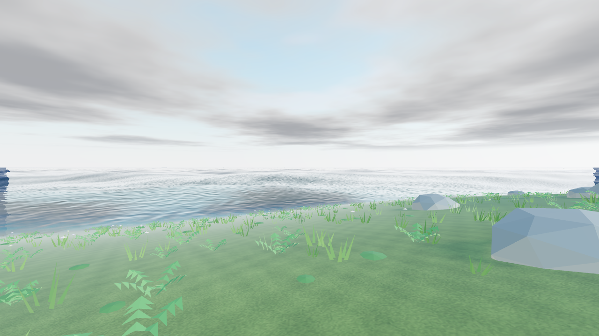
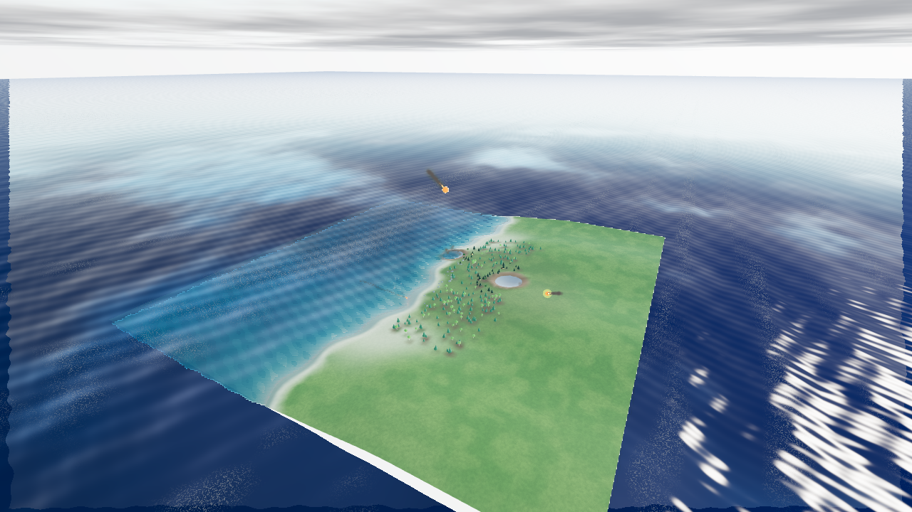

# Прибой, свободные руки и Армагеддон — 0.16.0

## Изменения

- Клавиша **0** и кнопки **«Убрать»** освобождают руки. Обе модели и источники
  света скрываются, переключение света недоступно. Фонарик и лампа остаются
  в инвентаре; **1 / 2** возвращают предмет. Состояние `none` участвует
  в проверке проекта, сохранении, восстановлении и истории.
- Ветер до **3** усиливает и удлиняет волнение. Четыре волны Герстнера
  рассчитываются одинаково в CPU и GLSL. На мелководье амплитуда ограничена
  глубиной и высотой наката. Сухая полоса берега временами затапливается
  гребнями; добавлены пена гребней и мокрый берег с учётом наката.
- Локальные водоёмы получили подразделённую сетку с запасом на берег и карту
  границы. Накат выходит за контур по сухому берегу, но не заливает низкую
  местность снаружи авторского контура. Геометрия ограничена 25 921 вершиной
  на водоём; карты границы и сетки освобождаются при пересоздании.
- В меню прогулки добавлен **«Армагеддон»**: случайные группы падений
  до ручной остановки. Диаметры метеоритов в обоих сценариях — **0,4–48 м**,
  крупнейшие редки. Контакт учитывает радиус тела, в том числе при ударе в воду.
- Общий фиксированный шаг 1/120 с. Звуки принадлежат отдельным метеоритам.
  Пулы эффектов и число пожаров ограничены; завершённые эффекты переиспользуются.
  За каждый удар сохраняется сид операции `meteor`; последствия отменяются
  через общую историю. Одновременные в одном шаге удары объединяются в запись.
- Меню, инвентарь, фоторежим и потеря фокуса приостанавливают сценарий.
  Остановка освобождает эффекты и звук. Кратеры и повреждения остаются в мире;
  состояние незавершённого метеоритного дождя в проект не записывается.

| Качество | Одновременные полёты | Пулы полётов/последствий | Суммарная ёмкость частиц |
|---|---:|---:|---:|
| Экономное | 3 | 6 | 360 |
| Сбалансированное | 4 | 8 | 832 |
| Высокое | 5 | 10 | 1520 |

## Проверка 20 октября 2026

- `npm test`: **203 / 203**, ошибок и пропусков нет. Добавлены проверки
  пустых рук и истории, диапазона размеров и контакта крупных тел,
  одновременных звуков, ограничений пула, остановки и отмены. Повторяемость
  ударов проверяется при 10/30/144 FPS. Водные тесты проверяют рост волн,
  ограничение мелководьем, затопление и осушение пляжа, границы водоёмов.
- Strict TypeScript, production-сборка и автономный HTML собраны успешно.
- Рабочий редактор проверен через `/storm-check.html` с отдельной IndexedDB.
  **1 → «Убрать» → инвентарь**, затем **2 → 0**: руки свободны, оба предмета
  доступны. В сохранённых настройках — `none`, свет выключен.
- На сухом пляже `x=3, z=0` при ветре 3 поверхность менялась от **−1,51 м**
  до **+0,76 м** относительно земли: вода накатывает и отступает.
- «Армагеддон» запущен настоящей кнопкой меню. В скачанном отчёте —
  **4 одновременных полёта, 5 ударов за 13,975 с**, ёмкость 832 частицы.
  К моменту остановки — 11 ударов. Меню приостанавливало падения;
  после остановки — 0 полётов и 0/0 частиц, кратеры сохранены.
- Озеро, река и подводный вид проверены в `/water-check.html`.
  Ошибок JavaScript и компиляции шейдеров не обнаружено. PNG экспортируется
  через обычный фоторежим, включая воду и несколько метеоритов.

[Данные браузерной проверки](storm-v016/browser-check.json).
Повторение: `npm run verify:storm`, `npm run preview`, открыть `/storm-check.html`.
Готовое побережье: [storm-coast.json](../examples/storm-coast.json).

## Границы модели

Прибой — ограниченная модель волн с накатом и пеной, без переворачивающихся
гребней, объёмных струй и полной гидродинамики. Высота зависит также от ползунка
«Волны» и глубины; значение 0 отключает ветровое волнение. Разрешение далёкой
поверхности и берега ограничивается качеством. Постоянные водоёмы и русла
сами от волн не меняются. Это проверка поведения и изображения; отдельный
новый замер целевой частоты кадров для всех миров не проводился.
