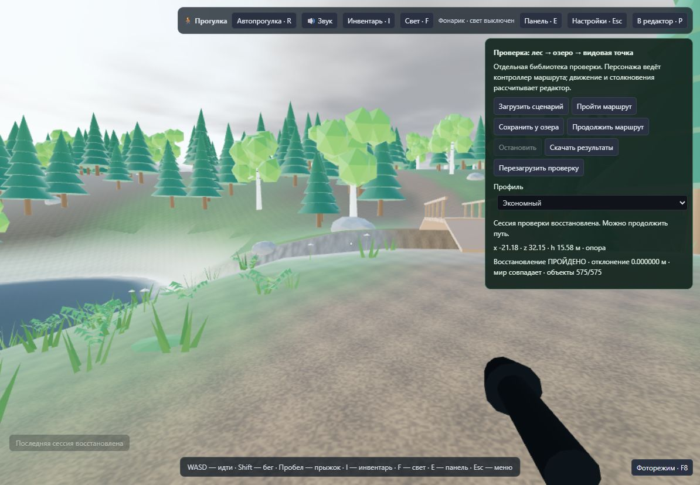
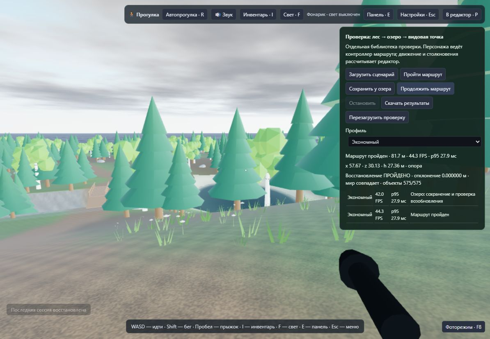

# Проверка прогулочного сценария · задача 32 · версия 0.13

Проверен маршрут «лес → озеро → мост через протоку → видовая точка» на текущем компьютере. Для повторения сохранён [готовый проект](../examples/forest-lake-viewpoint.json): сид 32032, сетка 256 × 256, 575 моделей, отдельное озеро и протока, тропа примерно 130 м и три сохранённых ракурса. Начальная позиция уже находится в режиме прогулки. Проект использует экономный профиль, рекомендованный по результатам проверки Intel UHD.

## Воспроизведение

Обычная прогулка: загрузить `examples/forest-lake-viewpoint.json` через раздел «Файлы» редактора. WASD — движение, Shift — бег, пробел — прыжок, R — автопрогулка по прямой, E — панель, Esc — настройки, P — редактор. Избранные ракурсы «Лес», «Озеро», «Видовая точка» доступны в фоторежиме.

Для автоматического контрольного прохода:

```sh
npm run build
npm run verify:walk
npm run preview
```

Открыть `http://127.0.0.1:4173/walk-check.html`. Выбрать профиль и нажать «Пройти маршрут». Команда `verify:walk` отдельно проверяет TypeScript проверочной страницы, заново создаёт пример мира и собирает страницу в `dist`. Проверка использует настоящие системы редактора: материалы, растительность/LOD, воду, погоду, звук, фиксированный шаг физики и капсулу Rapier. Контроллер задаёт только направление взгляда и флаг автопрогулки: координаты не переставляются по маршруту. Опора, подъёмы и столкновения вычисляются обычным кодом приложения.

Страница использует отдельную IndexedDB `terrain-editor-walk-check`; библиотека `terrain-editor-worlds` не подменяется. Для сохранения у озера есть отдельная кнопка: после остановки нажать «Перезагрузить проверку», проверить строку восстановления и затем «Продолжить маршрут». Из интерфейса можно скачать JSON с исходными интервалами кадров, координатами, фактическим адаптером, разрешением, профилем и итогами восстановления.

## Найденные и исправленные ошибки

1. **Ложная потеря опоры между досками моста.** Один вертикальный луч попадал в узкую щель и видел дно протоки. Автопрогулка считала настил небезопасным и останавливалась. Теперь при заметном падении опоры дополнительно проверяются четыре точки в пределах капсулы. Обычная ровная поверхность сохраняет проверку одним лучом. Такой же выбор опоры используется для шагов, поэтому щель не переключает звук дерева на грунт.
2. **Остановка из-за одного контакта со стыком.** Rapier иногда возвращает нулевой горизонтальный сдвиг на одном шаге при проходе стыка. Теперь автопрогулка останавливается при непрерывном отсутствии продвижения в течение 0,25 с; проверка опасного участка по-прежнему останавливает её сразу. Постоянные препятствия остаются непроходимыми.
3. **Избыточная стоимость экономного профиля.** Для него снижено внутреннее разрешение с DPR 0,9 до 0,75, процедурный шум земли использует одну октаву вместо четырёх. Сбалансированный использует две, высокий — четыре. При уменьшении числа октав нормировка сохраняет диапазон шума. Это осознанное снижение графической нагрузки, а не сравнение одинакового качества: карты материалов и схема покраски продолжают использоваться, изображение экономного профиля менее чёткое.
4. **Повторный расчёт мини-карты при автосохранении позиции.** Высотное превью не зависит от камеры и времени суток. Теперь оно повторно используется, пока не изменились рельеф, водоёмы, уровень океана или граница снега. Изменения этих данных сбрасывают кэш. Полный проект и актуальная позиция продолжают сохраняться.

`src/editor.ts` содержит фабрику приложения; `src/main.ts` остаётся обычной точкой запуска. Необязательные наблюдатели кадров и шагов физики нужны проверочной странице; основной редактор их не включает.

## Функциональные проверки

- Один маршрут полностью пройден с настоящим Rapier при моделируемом рендеринге 10, 30, 60 и 144 FPS. Персонаж дошёл до одной области назначения с расхождением меньше 0,5 м, прошёл по настилу моста, не перешёл в плавание и не оказался под рельефом. Это проверка устойчивости физики, не аппаратные замеры FPS.
- Автоматический тест сохранения использует настоящий код формата проекта и репозитория с `fake-indexeddb`: закрывает/открывает базу, восстанавливает мир и позу в новом экземпляре систем и заканчивает путь. Сравниваются рельеф, покраска, объекты, маршруты, водоёмы и сиды. Отдельно проверено, что пользовательская база остаётся нетронутой. Проверка нативной IndexedDB в браузере приведена ниже отдельно.
- Регрессии Rapier проверяют деревья и камни, стены/входы домика, арки и пещеры, мосты и причалы, ступени и предельные уклоны, обновление коллизии после редактирования.
- Проверены короткий контакт со стыком и постоянная стена: первый не отключает автопрогулку, вторая её останавливает.
- Проверены расчёт реального FPS с длинными кадрами, кэш мини-карты и его сброс при изменении исходных данных.

## Методика аппаратных замеров

Windows, встроенный браузер Codex, ANGLE / Intel UHD Graphics (0x46A3) / Direct3D 11. Окно 1194 × 828, системный DPR 1. Сцена и движение одинаковые; разные профили намеренно меняют разрешение, дальности LOD/растительности, тени, отражения и стоимость материалов. Это полный редактор, а не лаборатория WebGPU.

Перед проходом — 3 с прогрева. Дальше записывается каждый реальный интервал `requestAnimationFrame`, в том числе длинные кадры. Средний FPS вычисляется как число кадров / суммарное время; p95/p99 относятся к интервалам кадров. Поле `cpuMs` — длительность выполнения одного `animate` на главном потоке с отправкой команд драйверу, без явного ожидания GPU; это не чистое время GPU и может включать задержки драйвера. При скрытии вкладки прогон прерывается. Переключения фокуса записываются отдельно; маршрут принадлежит проверочному контроллеру, поэтому обычный сброс клавиш при потере фокуса не превращается в ложную ошибку проходимости.

Измерения — контрольные прогоны на одном компьютере, без контроля питания, температуры и фоновых процессов. Они не гарантируют такую же скорость в других мирах или браузерах. Для оценки обычного запуска без панели проверки небольшой запас на её наблюдатели также нужно учитывать.

Исходный прогон до настройки профилей: экономный 28,3 FPS / p95 41,8 мс, сбалансированный 22,4 / 55,6 мс, высокий 18,1 / 97,3 мс. После настройки экономный показал 47,5 / 27,9 мс в первом прогоне. Исходные данные сохранены в [before-optimization.json](walk-v013/before-optimization.json) и [after-optimization.json](walk-v013/after-optimization.json); последний предшествует кэшу превью. Сравнение профилей не следует трактовать как ускорение при неизменном изображении.

## Итоговые замеры · 16 октября 2026

Все три полных прохода завершены, фактически пройдено около 128,4 м за 29,5 с. Вкладка оставалась видимой, переключений фокуса не было. Исходные кадры и параметры находятся в [final-profiles.json](walk-v013/final-profiles.json).

| Профиль | Буфер рендера | Средний FPS | p95 кадра, мс | Максимальный кадр, мс | Кадров дольше 100 мс | Вызовы отрисовки, p95 |
| --- | --- | ---: | ---: | ---: | ---: | ---: |
| Экономный | 895 × 621 | 44,1 | 28,1 | 125,2 | 1 | 95 |
| Сбалансированный | 1194 × 828 | 22,9 | 69,5 | 152,7 | 3 | 230,4 |
| Высокий | 1194 × 828 | 17,6 | 97,3 | 159,4 | 23 | 268,1 |

Дробные значения p95 — результат интерполяции между соседними кадрами. Для экономного профиля медиана кадра составила 20,9 мс, p99 — 41,7 мс. p95 выполнения `animate` с отправкой команд драйверу — 3,38 мс; это не длительность GPU. В каждом полном проходе превью мира было рассчитано один раз, затем использовался кэш.

**На этом Intel UHD рекомендуется экономный профиль.** В двух контрольных проходах после настройки он показал примерно 44–48 FPS при p95 около 28 мс. Сбалансированный и высокий на текущем компьютере заметно менее плавные. Стабильные 60 FPS не достигнуты; редкие длинные кадры остались и в экономном профиле. Кэш убирает повторный расчёт превью, но не устраняет всю стоимость сериализации, сохранения и работы драйвера. Большие миры и другие настройки требуют отдельного измерения.

## Восстановление в браузере

Проверка выполнена с нативной IndexedDB встроенного браузера. У озера сохранён проект и позиция `x −21,18; z 32,15`, затем страница полностью перезагружена. Восстановление прошло: отклонение позиции — **0,000000 м**, все **575 объектов** на месте, совпали профиль и направление взгляда. SHA-256 от закодированного рельефа, покраски, данных мира, сидов, операций и настроек прогулки совпал. Дата сохранения, текущая погода и позиция камеры исключены из отпечатка; позиция и направление проверяются отдельно.



После восстановления пройден оставшийся участок **81,7 м** через мост до видовой точки, конечная позиция `x 57,67; z 30,13`. Средний FPS — **44,3**, p95 — **27,9 мс**, максимальный кадр — 124,9 мс. Вкладка оставалась видимой, переключений фокуса не было. Перед началом контроллер синхронизирует интерфейс прогулки, чтобы меню паузы и размытие фона были закрыты. Сохранение контрольной точки проверяется однократно: дальнейшая перезагрузка не сравнивает новую позицию с прежним берегом озера.

Два этапа этого прохода и результат сравнения сохранены в [final-results.json](walk-v013/final-results.json). Данные трёх полных проходов по профилям находятся в отдельном `final-profiles.json`, указанном выше.



## Проверка сборки

- `npm test` — **147 тестов, 0 ошибок**.
- `npm run build` — strict TypeScript, обычная сборка, автономный редактор и автономная лаборатория WebGPU собраны успешно.
- `npm run verify:walk` — strict TypeScript проверочной страницы, генерация примера и отдельная сборка `walk-check.html` прошли.
- В консоли браузера во время итоговой проверки ошибок не зарегистрировано.

Полный маршрут и сохранение проверены в браузере через HTTP на localhost. Прямой запуск автономного HTML через `file://` в этой проверке не выполнялся: встроенный браузер ограничивает открытие локальных файлов. Успешная сборка автономного файла не заменяет проверку его запуска в другом браузере.
