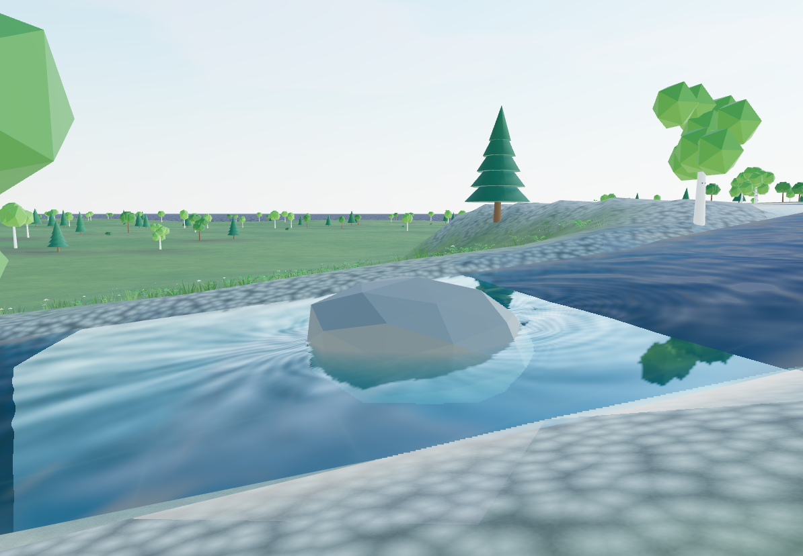
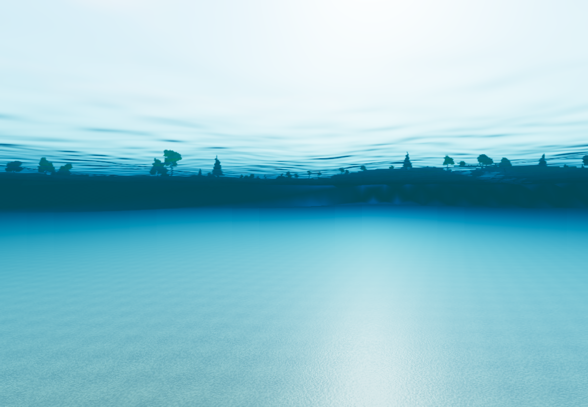

# Живая вода — 0.15.0

Реализованы первые три этапа улучшения воды. Используется существующий WebGL2-рендерер Three.js; ресурсы входят в автономный HTML.

## 1. Вид воды

- Общий захват цвета и настоящей глубины сцены перед водой. Преломление показывает реальное дно и подводные части моделей; проверка глубины не позволяет искажать передние объекты.
- Поглощение света по длине пути в воде и по каналам цвета. «Прозрачность …, м» задаёт дальность видимости дна; настройка доступна отдельно морю, озёрам и рекам.
- Отражение сцены относительно ближайшего уровня воды, отражение неба, Френель и солнечные блики. Исходный переключатель отражений сохранён.
- Мокрая полоса берега, пена у кромки и на течении, умеренные каустические блики мелководья.
- Подводный проход с затуханием света, цветовым поглощением и лёгким искажением. Фоторежим и PNG используют ту же последовательность отрисовки, включая обновление буферов после изменения размера снимка.

## 2. Движение поверхности

- Четыре волны Герстнера изменяют геометрию по горизонтали и вертикали. Один набор параметров формирует GLSL и расчёт для физики; запрос высоты обращает горизонтальное смещение.
- Направление и сила ветра управляют волнами. У моря длинное волнение, у озёр более короткие и слабые волны, у рек мелкая рябь с переносом по течению. На мелководье амплитуда затухает. При «Волны = 0» ветер не создаёт волнение; воздействия и течение остаются самостоятельными источниками движения.
- Морская сетка непрерывная, с логарифмическим расстоянием между вершинами: плотная рядом с камерой и редкая у горизонта. Озёра подразделяются с сохранением общего ребра; реки получают сетку вдоль и поперёк русла. Локальная геометрия ограничена бюджетом вершин.
- Локальная карта течения огибает камни, стволы и опоры встроенного причала. Физика читает те же округлённые значения с той же билинейной фильтрацией, что и шейдер.

## 3. Взаимодействие

- Вход и движение персонажа в воде создают затухающие круги и брызги. Дождь создаёт мелкие круги в видимой окрестности воды; погода переходит плавно.
- Погружение и движение плавающих предметов создают локальное возмущение. Число активных воздействий ограничено; физика и изображение используют одинаковый предел выбранного профиля.
- В «Редактирование объектов» добавлены «Плавучий предмет (в прогулке)» и относительная плотность. Плотность ниже 1 даёт плавание, выше 1 — погружение. Требуется отключённая привязка к рельефу; интерфейс делает это автоматически.
- Rapier рассчитывает динамический выпуклый коллайдер, столкновения с рельефом и предметами, подъёмную силу в восьми точках, сопротивление относительно течения и стабилизирующий момент. Шаг — 1/120 с. Для изображения положения интерполируются.
- Исходные трансформации остаются точками запуска. При выходе из прогулки предметы возвращаются в положение редактора; это положение сохраняется. Операции редактирования, настройки и признаки плавучести участвуют в истории и формате проекта. Динамические позы и короткие волны не засоряют историю и автосохранение.

## Профили качества

| Профиль | Отражение сцены | Преломление, доля размера окна | Морская сетка | Целевое ребро локальной сетки | Круги |
|---|---|---|---|---|---|
| Экономный | Только небо | 0,35 | 64×64 | 6 м | 8 |
| Сбалансированный | 256², интервал 0,08 с | 0,5 | 96×96 | 3 м | 16 |
| Высокий | 512², интервал 0,04 с | 0,75 | 128×128 | 2 м | 24 |

Преломление обновляется для текущей камеры каждый кадр. Дополнительные проходы переиспользуют карты теней. Буферы отражений освобождаются при отключении функции; буферы преломления меняют размер с профилем и окном. Физика ограничена 64 плавающими предметами.

## Проверка

- `npm test`: **193 / 193**. Новые проверки покрывают затухание волн, обращение горизонтального смещения, крайние настройки, ограничение и завершение кругов, карту течения, бюджеты сетки, плавание и плавучесть при 10/60/144 FPS, погружение плотных предметов и столкновение с дном.
- Отдельно проверены сохранение/отмена новых параметров, атомарный отказ при некорректных данных, сохранность вручную изменённого дна при изменении внешнего вида воды, восстановление состояния рендера при ошибке захвата.
- `npm run build`: strict TypeScript, обычная сборка и автономные HTML.
- `npm run verify:water` создаёт `dist/water-check.html`; `npm run verify:walk` сохраняет прежнюю проверку прогулочного маршрута.
- В браузере проверены реальное преломление и отражения, река, подводный проход, плавающие брёвна, круги, брызги, дождь и переключение качества. Ошибок WebGL/JavaScript не обнаружено. Снимки статистики — контроль работы функций, не полноценный бенчмарк FPS.

Пример для загрузки через «Файлы»: [living-water.json](../examples/living-water.json). Проверочная страница использует отдельную библиотеку `terrain-editor-water-check`.

## Границы модели

Течение — ограниченное приближение потенциального потока, без расчёта расхода, изменения русла и переноса объёма между водоёмами. Круги — аналитические затухающие возмущения в шейдере, а не сеточный решатель жидкости. Плавучесть приближает вытесняемый объём ограничивающим параллелепипедом, а столкновения используют выпуклую оболочку модели. Отражение геометрии выполняется для одного ближайшего уровня за раз, остальные уровни используют небо. Преломление ограничено изображением текущей камеры. Эти ограничения удерживают стоимость на существующем WebGL2-рендерере; FFT и полный перенос на WebGPU сюда не входят.
