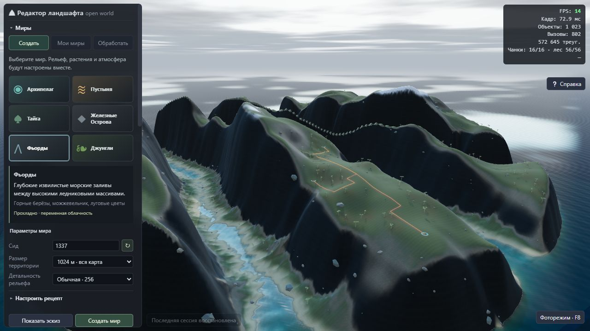
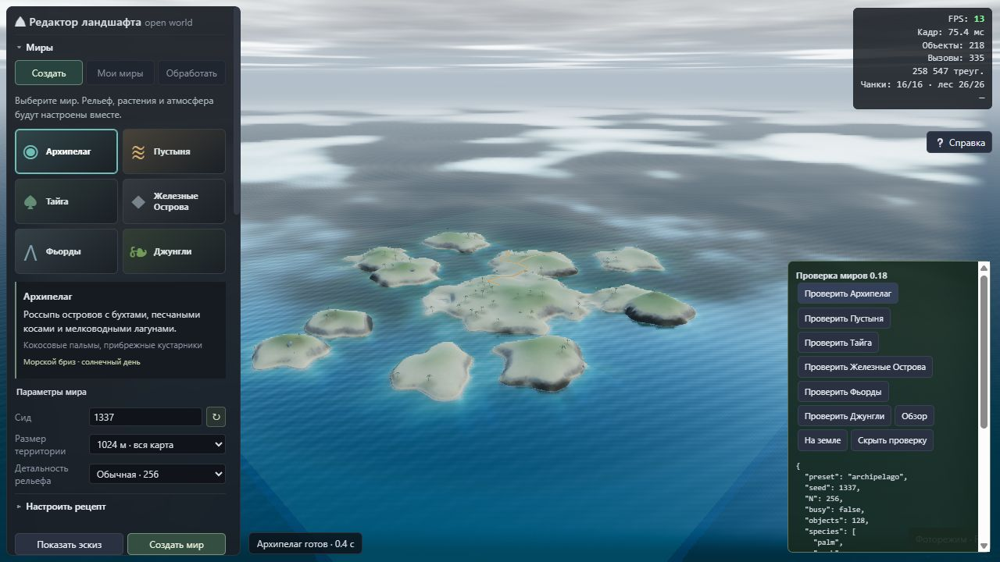
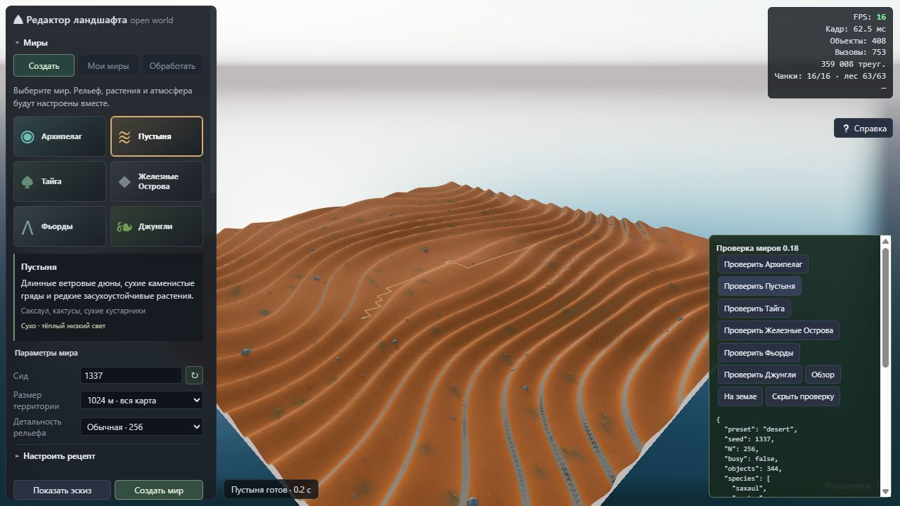
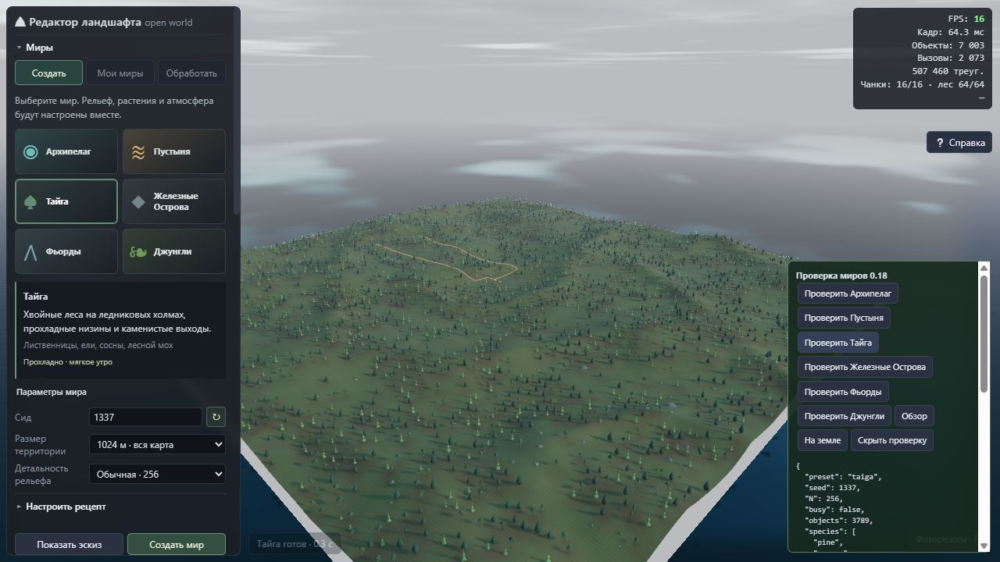
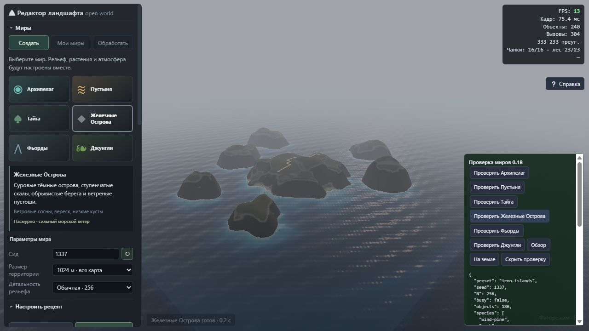
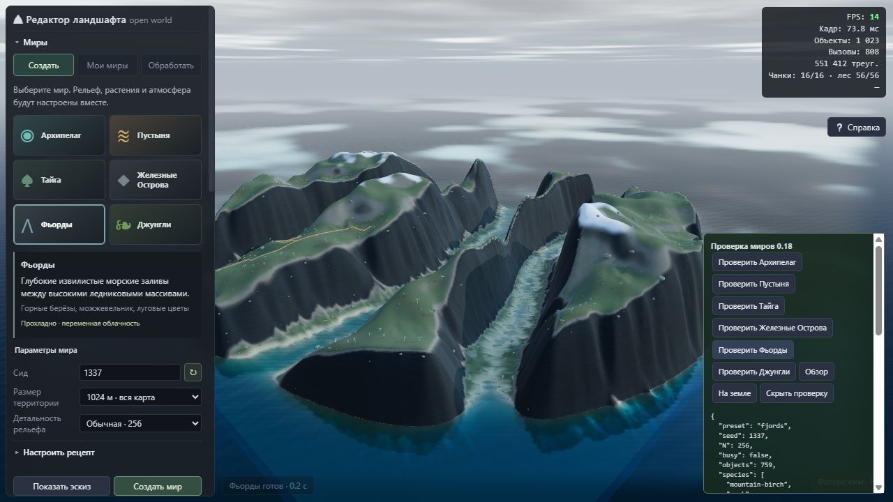
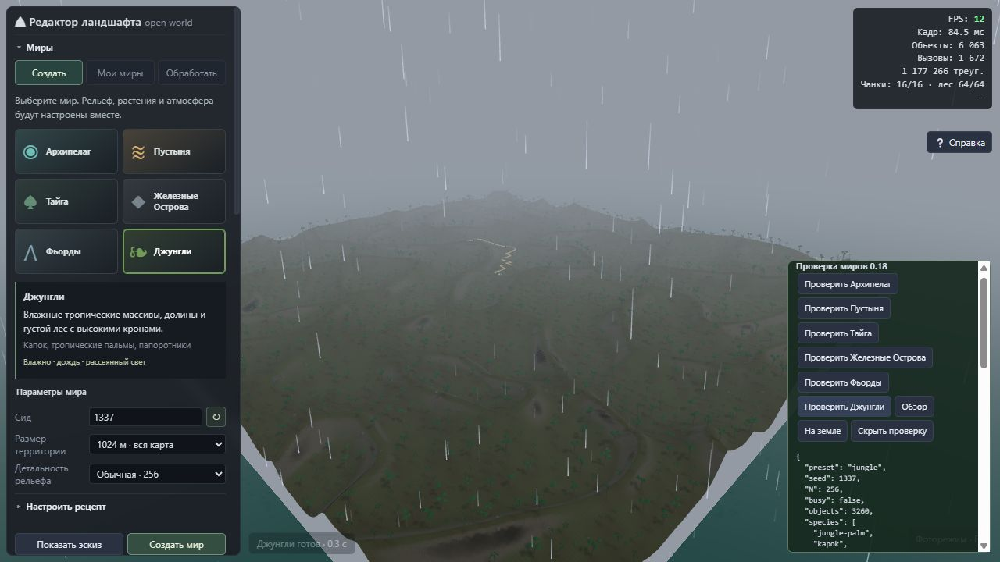
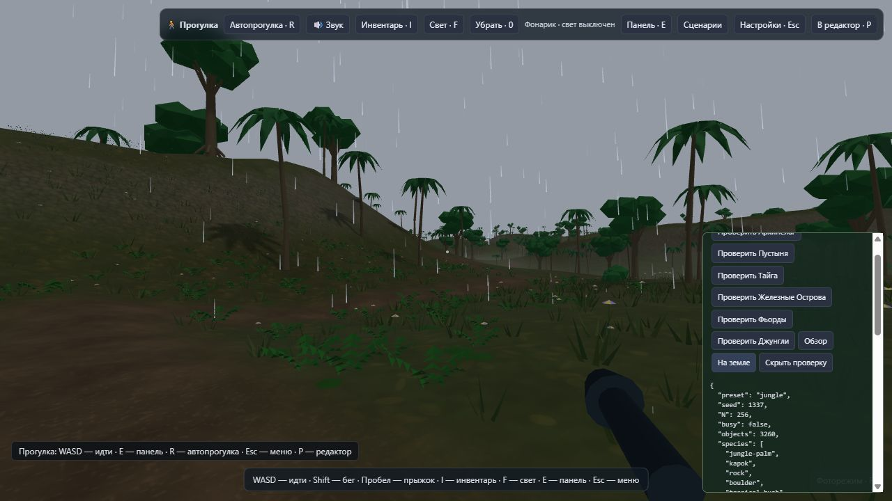

# Создание миров — 0.18.0

Дата проверки: 23 октября 2026 г.

## Что изменилось

Вместо четырёх независимых разделов появился раздел **«Миры»** с тремя вкладками:

- **Создать** — выбрать один из шести типов мира, сид, размер территории и детальность, затем нажать «Создать мир».
- **Мои миры** — библиотека с превью, отдельными записями и восстановлением последней сессии.
- **Обработать** — ручное изменение рельефа, дополнительная эрозия, локальные биомы, композиция и прежние четыре пресета.

Создание нового мира сначала сохраняет текущий проект в библиотеку. Новому миру присваивается отдельный идентификатор и название вида «Фьорды · 1337». Обычное изменение параметров рецепта не запускает генерацию и не меняет открытый мир.

Кнопка **«Показать эскиз»** вычисляет небольшую карту высот 64×64 до эрозии. Эскиз помогает выбрать сид и форму территории, не затрагивая историю, объекты или автосохранение. Для уточнения рецепта доступны высота, масштаб, острота, доля гор, изгибы, степень обработки, растения и маршруты. Размер территории: от 128 до 1024 м; обычная детальность — 256 ячеек на сторону карты.

## Шесть рецептов

| Мир | Рельеф и поверхность | Растения | Погода и освещение |
| --- | --- | --- | --- |
| Архипелаг | Группа островов, бухты, песчаные косы, мелководье и бирюзовая вода | Кокосовые пальмы и прибрежные кустарники | Переменная облачность, морской бриз, высокое дневное солнце |
| Пустыня | Асимметричные ветровые дюны, сухие гряды, тёплый песок | Саксаул, кактусы, сухие кустарники | Ясно, сухо, низкое тёплое солнце |
| Тайга | Ледниковые холмы, камни, влажная лесная почва | Лиственницы, ели, сосны, кусты и мох | Прохладное утро, переменная облачность, туман в низинах |
| Железные Острова | Тёмные скалистые острова, уступы и обрывистые берега | Ветровые сосны, вереск, низкие кусты | Сплошная облачность, сильный морской ветер и волны |
| Фьорды | Извилистые глубокие заливы между высокими массивами, снег на вершинах | Горные берёзы, можжевельник, луговая растительность | Прохладный свет, переменная облачность |
| Джунгли | Тропические гряды, долины, влажная подстилка | Капок, тропические пальмы, кустарники, папоротники | Дождь, высокая влажность, рассеянный свет |

Добавлены **13 локальных видов растений**; библиотека теперь содержит 31 встроенную модель. У новых видов три уровня детализации, непрозрачная геометрия и не более двух частей с отдельными материалами на модель. Они входят в GLB-пакет и автономный HTML. Это процедурные стилизованные модели, а не фотограмметрические ассеты.

## Какие подходы использованы

В [World Creator пресеты](https://docs.world-creator.com/reference/presets) объединяют повторно используемые настройки, а [биомы](https://docs.world-creator.com/reference/terrain/biome) согласуют распределение и оформление областей. Здесь та же идея применена к полному рецепту мира: одна запись описывает рельеф, виды растений, грунт, воду и атмосферу.

В [рабочем процессе Gaea](https://docs.gaea.app/using/index.html) форма рельефа, обработка и последующие стадии разделены. Его [генераторы рельефа](https://docs.gaea.app/reference/nodes/terrain) также задают узнаваемые исходные формы. В редакторе сначала строится характерная макроформа — острова, дюны или фьорды, — затем применяется подходящая обработка, маршруты, растительность и материалы. Разные миры не сводятся к перекрашиванию одного шума.

В [Unreal PCG Biome](https://dev.epicgames.com/documentation/unreal-engine/procedural-content-generation-pcg-biome-core-and-sample-plugins-in-unreal-engine) показан подход с биомами на основе данных и общими правилами размещения; Epic обозначает этот набор как экспериментальный. Здесь использован более компактный каталог TypeScript и существующая система масок влажности, уклонов, лесов и полян. Это адаптация подхода к автономному браузерному приложению, а не подключение Unreal.

Инженерный выбор для текущего приложения: сохранить CPU-карту высот, необходимую редактированию, физике и сохранению, а вычисления выполнять в Web Workers. Переход всего редактора на другой графический движок не требуется для этого изменения.

## Устройство и оптимизация

1. Рецепты определены данными в `src/world-recipes.ts`; геометрия создаётся в `src/world-terrain.ts`. Используются воспроизводимые шумы, деформация координат, поля островов, асимметричные дюны и извилистые каналы. Макроформа вычисляется в координатах мира, поэтому изменение разрешения не выбирает другой ландшафт.
2. Генерация и автоматическая эрозия объединены в один вызов фонового конвейера `src/terrain-pipeline.ts`. Основной поток получает итоговую карту, без промежуточной перестройки сетки после каждой стадии. Для пустыни используется небольшая термическая обработка без гидравлической эрозии.
3. Передача результата использует существующий механизм transferable ArrayBuffer. [MDN описывает передачу владения таким буфером](https://developer.mozilla.org/en-US/docs/Web/API/Web_Workers_API/Transferable_objects) без копирования его содержимого между потоками. Локальные копии для кэша и истории при этом сохраняются.
4. Кэш LRU ограничен четырьмя картами. Ключ включает параметры, влияющие на высоты, но не экспозицию или настройки графики. Эскиз работает отдельным фоновым исполнителем. Отмена завершает работу и восстанавливает предыдущий документ целиком.
5. Для расстановки новых миров заранее выбираются сухие ячейки. Это сокращает бесполезный поиск над морем. В пределах биома сохраняются рощи, поляны и влияние влажности. У точек старта очищается пространство.
6. Маршруты ищутся в крупнейшей связной области доступной суши. Коридоры дополнительно проверяются на воду; генератор не соединяет острова земляными перемычками. На слишком маленьком или крутом участке маршрут может не появиться.
7. Полный результат публикуется одной операцией истории. Ошибка или отмена не оставляет половину нового мира. Для нового проекта библиотека отдельно сохраняет прежний мир.

Новых сторонних зависимостей и дополнительных проходов постобработки для пресетов не добавлено.

## Сохранение и совместимость

Формат проекта повышен до **9**. Сохраняются идентификатор типа мира, версия рецепта, сид, степень эрозии, включение растений и маршрутов; остальные параметры остаются в состоянии проекта. Файлы форматов 1–8 по-прежнему загружаются. Уже созданные миры не перегенерируются при открытии.

Новый рецепт проверяется полностью перед применением файла. Неизвестная версия, неверный сид или некорректные опции отклоняются без изменения текущего проекта.

## Результаты проверки

- `npm test`: **230 из 230** тестов прошли; [полный журнал](worlds-v018/tests.log).
- `npm run build`: модели, TypeScript, Vite, автономный HTML и отдельная WebGPU-лаборатория собраны успешно; [журнал](worlds-v018/build.log).
- `npm run verify:worlds`: строгая проверка диагностического кода и сборка отдельной проверочной страницы прошли; [журнал](worlds-v018/verify.log).
- Новые тесты проверяют воспроизводимость всех шести макроформ, покрытие сушей, эрозию и прогресс, кэш, изоляцию эскиза, отмену, undo/redo, сохранение рецепта, миграцию старого формата, растения, границы карты и наличие полян.
- В браузере созданы все шесть миров с сидом 1337 и детальностью 256. Все операции завершились успешно; зарегистрированных ошибок JavaScript, шейдеров и потери WebGL-контекста нет. [Состояние с шестью результатами](worlds-v018/jungle-state.txt).
- Через обычный интерфейс автономной сборки проверены эскиз, создание фьордов, отдельная запись в библиотеке и сохранение предыдущего мира. После перезагрузки появилась надпись «Последняя сессия восстановлена», сохранились тип мира и настройки. [Библиотека](worlds-v018/offline-library-state.txt), [восстановление](worlds-v018/offline-restored-state.txt).
- Браузерные проверки используют отдельные тестовые базы IndexedDB и не меняют пользовательскую библиотеку.
- Автономный HTML проверен сборщиком на отсутствие внешних ресурсов и импортов. В браузере он проверялся через локальный HTTP-сервер, без подгрузки ресурсов приложения; отдельное испытание с физически отключённой сетью не проводилось.

Проверка чистого вычислительного конвейера на 18 комбинациях (шесть миров × три сида, N=256, мягкая обработка) дала **36–187 мс** в Node на этой машине. [Исходные измерения](world-recipes-metrics.json). Это время высот и эрозии, без растений, GPU, интерфейса и сохранения. Измерения не являются сравнением FPS до и после изменения.

Корневой и `dist`-экземпляры `terrain_editor_standalone.html` совпадают побайтово: 6 600 073 байта; SHA-256 `44ebcb9a9b40cfd61eda362014006d2580861aad6923ddd8f96808dc2a9cac0a`.

## Снимки

| Архипелаг | Пустыня |
| --- | --- |
|  |  |
| Тайга | Железные Острова |
|  |  |
| Фьорды | Джунгли |
|  |  |

Повторная проверка: `npm test`, `npm run build`, `npm run verify:worlds`, `npm run preview`, затем `/world-studio-check.html`.
